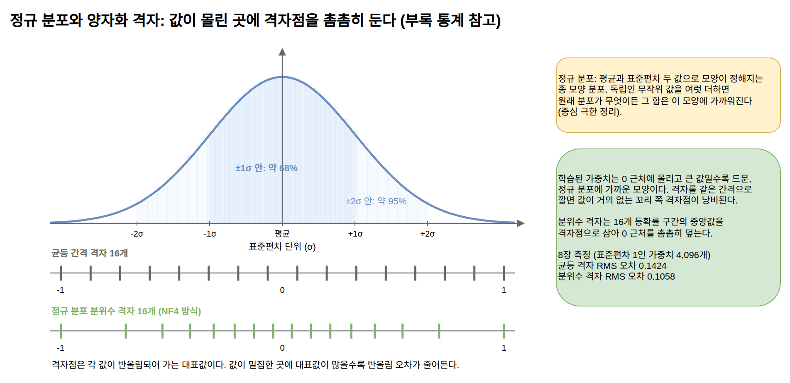
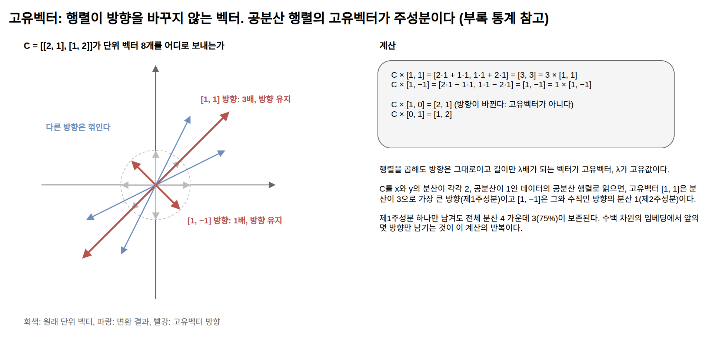
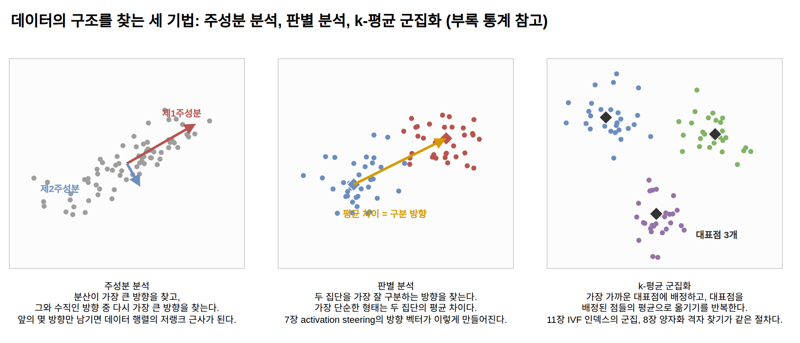
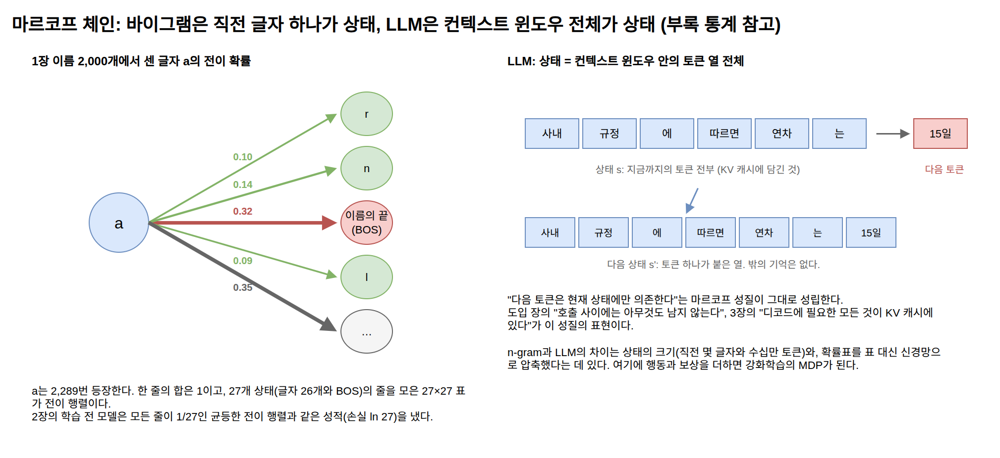
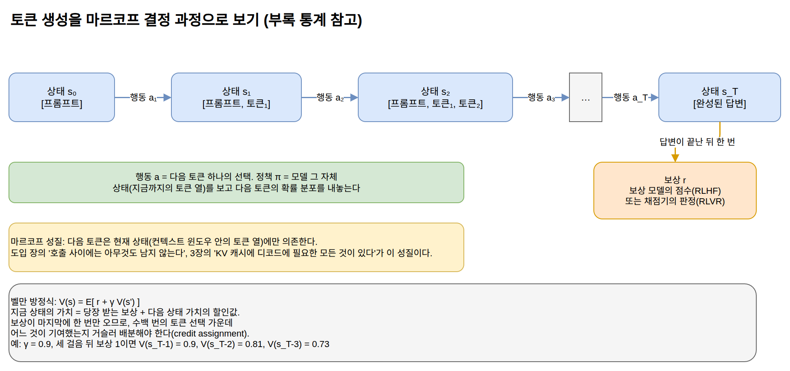
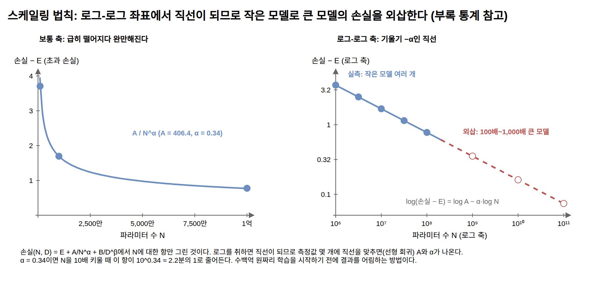
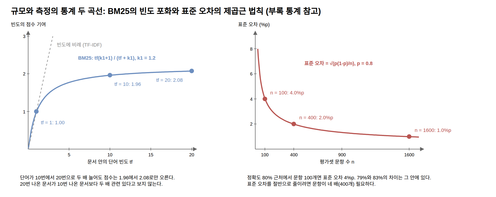
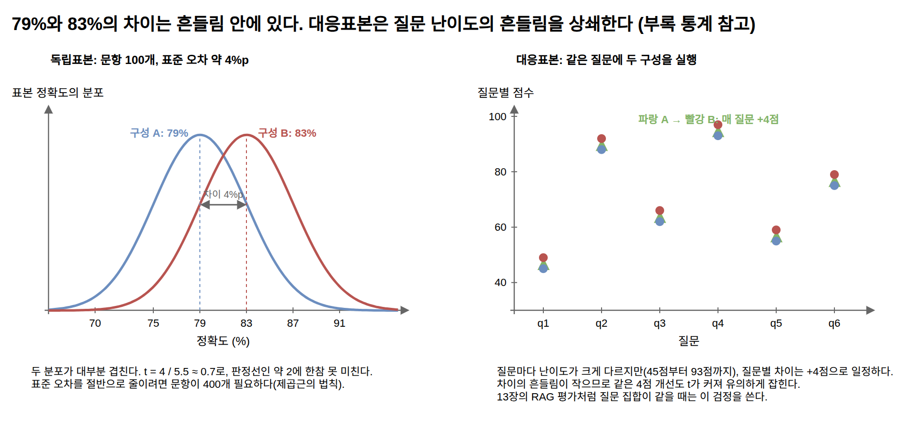

[appendix]
[[appendix-statistics]]
= 통계 참고

4장은 microGPT 두 장과 추론 서빙 장을 읽는 데 필요한 수학만 다룬다. 이 부록에는 그 밖의 장이 참조하는 통계 개념을 모았다. 가중치와 측정값에서 나타나는 정규 분포, 데이터의 구조를 찾는 상관·주성분·군집, 가장 단순한 신경망에 해당하는 회귀, 토큰 생성을 확률 과정으로 보는 마르코프 체인과 강화학습, 규모와 측정의 통계(스케일링 법칙, 검색 점수, 유의성 검정)다.

차례로 읽지 않아도 된다. 본문이 이 부록을 가리킬 때 그 절만 찾아 읽으면 되도록, 절마다 첫머리에 이어지는 장을 적었다. 식의 표기와 읽는 법은 4장 첫머리의 표를 따른다. 벡터, 내적, 로그, 분산처럼 4장에서 정의한 개념은 다시 설명하지 않고 4장을 가리킨다.

[cols="2,4,3"]
|===
| 절 | 개념 | 이어지는 장

| 정규 분포와 중심 극한 정리
| 정규 분포, 중심 극한 정리, 분위수
| 8장 NF4 양자화, 13장 평가셋

| 데이터의 구조
| 공분산, 상관계수, 주성분 분석, 판별 분석, k-평균 군집화
| 7장 activation steering, 8장 양자화, 11장 벡터 인덱스

| 회귀
| 선형 회귀, 로지스틱 회귀, 다중공선성
| 2장 lmHead, 5장 선호 학습과 분산 표현, 8장 GPTQ

| 확률 과정과 결정
| 마르코프 체인, 벨만 방정식
| 도입 장, 3장 KV 캐시, 5장 RLHF와 RLVR

| 규모와 측정
| 멱법칙, TF-IDF, BM25, 표준 오차, t-검정, 분산 분석
| 5장 기법별 데이터와 비용의 자릿수, 11장 키워드 검색, 13장 평가셋
|===

이 부록의 값도 ``examples/math-lab``의 검산 코드로 다시 계산해 볼 수 있다. 벨만 방정식과 강화학습은 부록 더 읽을거리의 Sutton과 Barto 교과서가 표준이고, 스케일링 법칙의 원 논문들도 더 읽을거리에 정리해 두었다.

=== 정규 분포와 중심 극한 정리

이어지는 장: 8장 NF4 양자화. 이 부록의 t-검정 절도 이 절의 중심 극한 정리를 쓴다.

**정규 분포**는 평균을 중심으로 좌우 대칭인 종 모양의 분포로, 평균과 표준편차 두 값으로 모양이 정해진다. 값의 약 68%가 평균 ±1 표준편차 안에, 약 95%가 ±2 표준편차 안에 들어온다. 고등학교 확률과 통계에서 배운 그 분포다.

정규 분포가 곳곳에서 나타나는 이유는 **중심 극한 정리**다. 서로 독립인 무작위 값을 여러 개 더하면, 개별 값이 어떤 분포를 따르든 그 합은 정규 분포에 가까워진다. 주사위가 예다. 주사위 하나의 눈은 1부터 6까지 확률이 모두 1/6인 평평한 분포다. 두 개를 던진 합은 7이 되는 경우가 여섯 가지로 가장 많고 2나 12가 되는 경우는 한 가지뿐이라 가운데가 높은 삼각형 모양이 되며, 더하는 개수를 늘릴수록 종 모양에 가까워진다. 4장 정규화 절의 d차원 내적도 항이 많은 합이라서 분산이 d일 뿐 아니라 분포 자체도 종 모양에 가까워진다.

LLM 실무에서 정규 분포를 만나는 자리는 두 곳이다. 첫째, 가중치 초기화는 평균 0의 정규 분포에서 작은 값을 뽑는 것이 표준이다. 둘째, 학습이 끝난 가중치들의 분포도 대체로 평균 0의 종 모양을 유지하는데, 8장의 NF4 양자화가 이 관찰을 이용한다.

4비트로 표현할 수 있는 값은 2⁴ = 16개뿐인데, 이 16개 격자점을 같은 간격으로 깔면 값이 거의 없는 꼬리 쪽 격자점이 낭비된다. NF4는 정규 분포를 확률이 같은 16개 구간으로 나누고 각 구간의 중앙값을 격자점으로 삼아, 값이 몰린 0 근처에 격자점을 촘촘히 둔다. 분포를 이렇게 같은 확률로 나누는 경계값이 분위수다. 구간 16개가 확률을 똑같이 나눠 가지므로 구간 하나에 값의 ``1/16 = 6.25%``가 들어간다. 표준 정규 분포(평균 0, 표준편차 1인 정규 분포)를 이렇게 나누면 0 근처 구간의 폭은 약 0.16이고 가장 바깥 경계는 ±1.53이라서, 그 너머의 꼬리 전체(각각 6.25%)가 구간 하나에 담긴다. 8장의 측정에서 같은 16개 점으로 균등 격자는 RMS 오차 0.1424, 분위수 격자는 0.1058을 냈다. 값이 0 근처에 몰린다는 것을 알면 격자점을 그쪽에 더 많이 둘 수 있다.

.정규 분포와 양자화 격자. 값이 몰린 곳에 격자점을 촘촘히 두면 같은 개수로 오차가 줄어든다

=== 데이터의 구조: 상관, 주성분, 군집

==== 공분산과 상관계수

이어지는 장: 11장 벡터 검색의 코사인 유사도.

*공분산*(covariance)은 두 변수가 함께 움직이는 정도다. 각 변수에서 평균을 뺀 값끼리 곱해 평균 낸 것으로, 한쪽이 클 때 다른 쪽도 큰 경향이면 양수, 반대로 움직이면 음수, 무관하면 0 근처다. 분산은 자기 자신과의 공분산이다.

----
cov(x, y) = 평균((x - x̄) * (y - ȳ))
상관계수  = cov(x, y) / (σ_x * σ_y)

x = [1, 2, 3, 4] (평균 2.5),  y = [2, 4, 5, 8] (평균 4.75)
x의 편차:  [-1.5, -0.5, 0.5, 1.5]
y의 편차:  [-2.75, -0.75, 0.25, 3.25]
편차의 곱: [4.125, 0.375, 0.125, 4.875]    평균 2.375가 cov(x, y)
σ_x ≈ 1.118,  σ_y ≈ 2.165
상관계수 = 2.375 / (1.118 * 2.165) ≈ 0.98
----

``x̄``와 ``ȳ``는 x와 y의 평균이고, σ(시그마)는 표준편차다. 위 예에서는 x가 평균보다 작을 때 y도 평균보다 작고 x가 클 때 y도 커서, 편차의 곱이 네 쌍 모두 양수다. 그래서 공분산이 양수다.

공분산의 크기는 값의 단위에 따라 달라진다. y를 10배 큰 단위로 적으면 공분산도 10배가 되므로 공분산만으로는 두 변수의 관계가 강한지 약한지 말하기 어렵다. 공분산을 두 변수의 표준편차로 나눠 -1에서 1 사이로 정규화한 것이 **상관계수**다. 위 예의 0.98은 두 변수가 거의 한 직선 위에서 함께 움직인다는 뜻이다. 이 식을 벡터 연산으로 바꿔 쓰면, 분자는 평균을 뺀 두 배열의 내적을 개수로 나눈 것이고 분모는 두 배열의 길이를 곱해 개수로 나눈 것이다. 개수가 약분되므로 상관계수는 "평균을 뺀 두 값 배열의 코사인 유사도"와 정확히 같은 계산이다. 11장의 벡터 검색이 쓰는 코사인 유사도(4장)가 통계의 상관계수와 같은 공식이므로, 벡터 검색은 "질의와 상관이 높은 문서 찾기"라고 바꿔 말할 수 있다.

==== 주성분 분석

이어지는 장: 7장 activation steering.

변수가 여러 개면 모든 쌍의 공분산을 행렬로 모은 **공분산 행렬**이 된다. 대각선 자리에는 각 변수의 분산이, 나머지 자리에는 두 변수의 공분산이 들어간다. 이 행렬에서 데이터의 주된 방향을 찾는 기법이 *주성분 분석*(PCA, Principal Component Analysis)이다. 고차원 공간에 흩어진 데이터에서 분산이 가장 큰 방향(제1주성분)을 찾고, 그와 수직인 방향 가운데 분산이 가장 큰 방향(제2주성분)을 찾는 일을 반복한 뒤 앞의 몇 방향만 남긴다. 예를 들어 여러 사람의 키와 몸무게를 2차원 점으로 찍으면 키가 클수록 몸무게도 큰 대각선 방향으로 점들이 길게 퍼지는데, 그 대각선이 제1주성분이다.

분산이 가장 큰 방향은 공분산 행렬을 곱했을 때 가장 크게 늘어나는 방향이고, 고유벡터로 찾는다. 벡터에 행렬을 곱하면 보통은 방향과 길이가 모두 바뀐다. 그런데 곱해도 방향은 그대로이고 길이만 λ(람다)배가 되는 벡터가 행렬마다 있다. 이 벡터를 *고유벡터*(eigenvector), 그 배율 λ를 고유값이라고 부른다. 공분산 행렬의 고유벡터가 주성분이고, 고유값이 그 방향의 분산이다.

----
C = [[2, 1],     x와 y의 분산이 각각 2, 공분산이 1
     [1, 2]]

C × [1, 0]  = [2*1 + 1*0,    1*1 + 2*0]    = [2, 1]                   방향이 바뀐다
C × [1, 1]  = [2*1 + 1*1,    1*1 + 2*1]    = [3, 3]  = 3 × [1, 1]     고유값 3, 제1주성분 방향 [1, 1]
C × [1, -1] = [2*1 + 1*(-1), 1*1 + 2*(-1)] = [1, -1] = 1 × [1, -1]    고유값 1, 제2주성분 방향 [1, -1]
----

[1, 0]은 곱한 뒤 [2, 1]이 되어 방향이 바뀌므로 고유벡터가 아니다. [1, 1]과 [1, -1]은 방향이 그대로이고 길이만 3배, 1배가 된다. x와 y가 함께 커지는 대각선 방향의 분산이 3, 그와 수직인 방향의 분산이 1이다. 전체 분산은 x의 분산 2와 y의 분산 2를 더한 4이고, 두 고유값의 합 ``3 + 1``과 같다. 제1주성분 하나만 남겨도 전체 분산 4 가운데 3, 곧 75%가 보존된다.

.고유벡터. 행렬 C가 단위 벡터 8개를 변환할 때 [1, 1]과 [1, −1] 방향만 방향을 유지하고 길이만 3배와 1배가 된다

수백 차원의 데이터라도 변동의 대부분이 몇 개의 방향으로 설명된다면, 그 방향들의 좌표만 남겨도 잃는 정보가 작다. 데이터 행렬을 앞의 k개 주성분만으로 다시 쓰는 것은 4장의 저랭크 근사와 같은 일이다. 수백 차원의 임베딩 벡터들을 2차원 그림으로 시각화할 때 흔히 쓰는 도구가 PCA다. 7장의 activation steering이 쓰는 "정직함 방향" 같은 방향 벡터도 활성값(모델의 중간 층이 내놓는 벡터) 데이터에서 통계적으로 뽑아낸 방향이고, 이때 주성분 분석을 쓰기도 한다.

==== 판별 분석

이어지는 장: 7장 activation steering.

주성분 분석이 "데이터가 가장 넓게 퍼진 방향"을 찾는다면, *판별 분석*(discriminant analysis)은 "두 집단을 가장 잘 구분하는 방향"을 찾는다. Fisher의 선형 판별 분석은 두 집단의 평균이 서로 멀고 각 집단 안의 흩어짐은 작도록, 집단 사이 분산과 집단 안 분산의 비율을 최대로 만드는 방향을 고른다. 가장 단순한 형태는 두 집단의 평균 벡터의 차이를 방향으로 삼는 것이다. 예를 들어 한 집단의 평균이 [1, 2]이고 다른 집단의 평균이 [4, 3]이면 방향은 두 평균의 차이인 [3, 1]이다. 새 데이터가 어느 집단 쪽인지는 이 방향 벡터와의 내적이 큰지 작은지로 가늠한다.

7장의 activation steering이 쓰는 방향 벡터가 이 아이디어로 만들어진다. 모델이 정직한 답변을 생성할 때의 활성값들과 그렇지 않을 때의 활성값들을 모아, 두 집단의 평균 차이를 "정직함 방향"으로 삼는다. 모델의 성향 하나가 고차원 활성값 공간의 방향 하나로 표현된다는 관찰은 통계학에서 오래 써 온 판별 분석의 용어로 그대로 설명된다.

==== k-평균 군집화

이어지는 장: 8장 양자화 격자, 11장 Vector DB 인덱스, 14장 GraphRAG.

*k-평균 군집화*(k-means clustering)는 데이터를 k개의 무리로 나누는 기법이다. 대표점 k개를 놓고 "각 데이터를 가장 가까운 대표점에 배정한다, 각 대표점을 배정된 데이터들의 평균으로 옮긴다"를 반복하면 대표점들이 데이터가 밀집한 곳으로 옮겨 간다. 예를 들어 1차원 값 [1, 2, 3, 10, 11, 12]에 대표점 두 개를 1과 2에 놓고 시작하면 다음과 같이 진행된다.

----
시작:  대표점 1 / 2
1회:   배정 {1} / {2, 3, 10, 11, 12}   →  대표점 1 / 7.6    (38 / 5 = 7.6)
2회:   배정 {1, 2, 3} / {10, 11, 12}   →  대표점 2 / 11
3회:   배정이 2회와 같으므로 멈춘다
----

처음에는 2부터 12까지가 모두 둘째 대표점 2에 더 가까워서 한 무리가 된다. 둘째 대표점이 그 무리의 평균 7.6으로 옮겨 가면 2와 3은 첫째 대표점 1에 더 가까워져서 배정이 바뀐다. 둘째 반복 뒤 대표점은 2와 11이 되고, 그 뒤로는 배정이 바뀌지 않아 멈춘다. 이 반복 절차를 Lloyd 알고리즘이라고 부른다.

.데이터의 구조를 찾는 세 기법. 주성분 분석은 퍼진 방향을, 판별 분석은 구분하는 방향을, k-평균은 대표점을 찾는다

임베딩 공간은 비슷한 것끼리 가까이 놓이도록 학습된 공간이라서, 그 안에서 대표점을 찾는 k-평균이 본문 여러 곳에서 쓰인다. 11장이 이름만 소개하는 Vector DB 인덱스 가운데 IVF가 이 방식이다. 전체 벡터를 k개 군집으로 미리 나눠 두고, 검색 때는 질의와 가까운 군집 몇 개만 뒤져 전수 비교를 피한다. 11장이 함께 언급하는 PQ(product quantization)도 벡터를 조각내어 조각마다 k-평균으로 대표점 목록(코드북)을 만들고, 각 조각을 가장 가까운 대표점의 번호로 바꿔 저장하는 압축 기법이다. 14장의 GraphRAG가 "군집별 요약을 미리 생성"할 때의 군집도 군집화의 결과물이다.

8장의 양자화와도 이어진다. "격자를 어디에 둘 것인가"라는 문제에서 NF4는 분포(정규 분포)를 안다는 전제로 분위수에 격자를 놓았다. 분포를 모른 채 데이터에서 직접 격자를 찾는 일반적인 방법이 1차원 k-평균이고, 값이 밀집한 곳에 대표점이 몰리는 최적의 양자화 격자가 같은 반복 절차로 나온다. k-평균의 대표점을 고르는 계산과 양자화의 격자점을 고르는 계산은 같은 계산이다.

=== 회귀: 가장 작은 신경망

==== 선형 회귀와 최소제곱법

이어지는 장: 2장 학습 루프, 8장 GPTQ.

**선형 회귀**는 데이터에 가장 잘 맞는 직선 ``y = ax + b``를 찾는 기법이다. a는 직선의 기울기이고 b는 x가 0일 때의 y값(절편)이다. "가장 잘 맞는"의 기준은 예측과 실제의 차이를 제곱해 더한 값(오차 제곱합)의 최소화다(최소제곱법). 입력이 여러 개면 직선이 평면으로, 계수 a가 벡터로 늘어날 뿐 식의 형태는 같다. 입력이 d개인 선형 회귀의 예측은 계수 벡터와 입력 벡터의 내적에 상수를 더한 것이다. 입력이 하나일 때는 해가 앞 절의 공분산과 분산으로 바로 쓰인다.

----
a = cov(x, y) / var(x),   b = ȳ - a * x̄

공분산 절의 x = [1, 2, 3, 4], y = [2, 4, 5, 8]이면
cov(x, y) = 2.375, var(x) = 1.25  →  a = 2.375 / 1.25 = 1.9,  b = 4.75 - 1.9 * 2.5 = 0

예측 y = 1.9x: [1.9, 3.8, 5.7, 7.6]
실제 y:        [2,   4,   5,   8]
----

``var(x)``는 x의 분산으로, 공분산 절에서 구한 표준편차 1.118의 제곱이다. 직선 ``y = 1.9x``의 예측은 실제 값과 조금씩 어긋나지만, 어긋난 양의 제곱합이 이보다 작은 직선은 없다. 기울기 a가 공분산을 분산으로 나눈 값이므로 회귀 계수는 상관계수와 같은 재료로 만들어진다. 상관계수가 -1에서 1 사이로 정규화한 방향 일치도라면, 회귀 계수는 그 관계를 y의 단위로 되돌린 값이다. 위 예의 a = 1.9는 x가 1 늘 때 y가 평균적으로 1.9 는다는 뜻이다.

선형 회귀는 이 책 곳곳에 있다. 신경망의 한 층은 다변수 선형 회귀 여러 개(출력 차원 수만큼)에 비선형 함수를 붙인 것이므로, LLM은 선형 회귀를 수억 개 쌓아 올린 구조로 볼 수도 있다. "손실을 정의하고 그것을 최소화하는 파라미터를 찾는다"는 학습의 형태 자체가 최소제곱법의 일반화다. 선형 회귀는 해를 공식으로 바로 구하지만 2장의 학습 루프는 경사 하강법으로 찾는다. 8장의 GPTQ가 양자화 오차를 보상할 때 최소화하는 대상도 층 출력의 오차 제곱합이고, 이 부록 뒤에서 볼 스케일링 법칙의 계수 추정도 로그를 취한 좌표에서 직선을 맞추는 회귀다.

==== 로지스틱 회귀와 시그모이드

이어지는 장: 2장 lmHead와 softmax, 5장 선호 학습.

**로지스틱 회귀**는 선형 회귀의 출력을 시그모이드 함수에 통과시켜 0과 1 사이의 확률로 바꾼 분류 기법이다.

----
sigmoid(z) = 1 / (1 + exp(-z))

z = -2 → 0.12,  z = 0 → 0.5,  z = 2 → 0.88

sigmoid(2) = 1 / (1 + exp(-2)) = 1 / (1 + 0.135) ≈ 0.88
----

z가 클수록 출력이 1에, 작을수록 0에 가까워지고 z가 0이면 정확히 0.5다. 어떤 실수를 넣어도 출력이 0과 1 사이에 있으므로 확률로 쓸 수 있다.

시그모이드의 도함수는 ``sigmoid(z) * (1 - sigmoid(z))``로, 출력이 0.5일 때 0.25로 가장 크고 출력이 0이나 1에 가까워지면 0에 가까워진다. 출력이 0.98이면 도함수는 ``0.98 * 0.02 ≈ 0.02``로, 0.5일 때의 약 13분의 1이다. 2장에서 softmax가 한 토큰에 확률을 몰아주면 기울기가 거의 흐르지 않는다고 한 것이 이 성질이다. 출력이 이미 극단에 있으면 로짓을 조금 움직여도 확률이 거의 변하지 않아 손실도 변하지 않고, 배울 신호가 사라진다.

시그모이드는 선택지가 두 개일 때의 softmax(4장)와 같은 함수다. 로짓이 ``[z, 0]``인 두 후보에 softmax를 적용하면 첫 후보의 확률은 ``exp(z) / (exp(z) + 1)``이고, 분자와 분모를 ``exp(z)``로 나누면 위의 식이 된다. 로지스틱 회귀의 손실(로그 손실)은 교차 엔트로피와 같은 식이다. 그러므로 LLM의 마지막 단계, 곧 `lmHead` 행렬 곱에 softmax를 적용하고 교차 엔트로피로 학습하는 부분(2장)은 선택지가 어휘 크기만큼 있는 로지스틱 회귀(다항 로지스틱 회귀)와 같은 구조다.

5장의 선호 학습에도 이 형태가 있다. RLHF의 보상 모델은 "답변 A가 B보다 선호될 확률 = sigmoid(A의 점수 - B의 점수)"라는 모형(Bradley-Terry 모형)으로 학습되고, DPO의 손실도 같은 시그모이드 형태다. 사람의 선호처럼 정답이 없는 품질도 학습할 때는 로지스틱 회귀와 같은 식으로 계산한다.

==== 다중공선성과 분산 표현

이어지는 장: 5장 모델 레이어의 분산 표현과 모델 편집.

회귀분석에서 함께 배우는 *다중공선성*(multicollinearity)은 통계 모형과 LLM이 계수를 대하는 방식의 차이를 보여 준다. 다중공선성은 입력 변수들끼리 강하게 상관되어 있을 때 생긴다. 계수를 어느 변수에 배분해도 예측이 비슷하므로, 예측은 멀쩡한데 개별 계수의 추정이 불안정해지고 해석이 무의미해진다. 예를 들어 키를 센티미터와 인치로 두 번 입력에 넣으면 두 계수가 효과를 어떻게 나눠 가져도 예측은 같다.

----
1인치 = 2.54cm이므로 다음 세 식의 예측은 모두 같다

y = 1.0 * 키(cm) + 0    * 키(인치)
y = 0   * 키(cm) + 2.54 * 키(인치)
y = 0.5 * 키(cm) + 1.27 * 키(인치)
----

세 계수 조합 가운데 어느 것이 답인지 데이터로는 정할 수 없으므로, "센티미터 키의 계수는 0.5"라는 추정값에는 의미가 없다. 통계 모형에서 이것이 문제인 이유는 계수 하나하나를 해석하려 하기 때문이다.

LLM에서는 이 현상이 훨씬 심하다. 파라미터들이 서로 얽혀 있어 어느 파라미터가 무엇을 담당하는지 특정할 수 없지만, 애초에 개별 해석을 포기하고 예측 성능만 취하므로 학습에는 지장이 없다. 5장에서 모델 레이어의 정보가 분산 표현이라 선택적으로 열람하거나 삭제할 수 없다고 한 것도, 모델 편집이 아직 연구 단계인 것도 이 성질 때문이다. 해가 하나로 정해지지 않는 성질이 계수를 읽으려는 통계학에서는 결함이고, 출력만 쓰는 LLM에서는 감수하는 전제다.

=== 확률 과정과 결정: 마르코프 체인과 벨만 방정식

==== 마르코프 체인

이어지는 장: 도입 장의 호출 구조, 1장 이름 데이터, 3장 KV 캐시.

*마르코프 체인*(Markov chain)은 "다음에 일어날 일이 현재 상태에만 의존하고, 거기까지 온 경로에는 의존하지 않는다"는 성질(마르코프 성질)을 만족하는 확률 과정이다. 상태마다 다음 상태로 옮겨 갈 확률이 정해져 있고, 그 확률표만 있으면 과정 전체를 전개할 수 있다.

4장의 확률 절에서 본 n-gram 언어 모델이 마르코프 체인이다. 상태를 "직전 n-1개 토큰"으로 잡고, 다음 토큰으로 옮겨 갈 확률표를 말뭉치에서 센 것이다. 1장의 이름 데이터로 말하면, 직전 글자가 "a"일 때 다음 글자가 "n"일 확률, "r"일 확률을 이름 목록에서 세어 표로 만든 것이 바이그램 모델이다. 1장의 이름 2,000개에서 세면 다음과 같다.

----
직전 글자가 a일 때 (a는 2,289번 등장)
  이름의 끝  0.32    n  0.14    r  0.10    l  0.09    ...
----

이 표의 한 줄이 상태 a에서 나가는 전이 확률이고, 27개 상태(글자 26개와, 이름의 시작과 끝을 표시하는 특수 토큰 BOS)의 줄을 모두 모은 27×27 표가 이 체인의 전이 행렬이다. 2장의 학습 전 모델은 모든 줄이 1/27인 균등한 전이 행렬과 같은 성적을 냈고, 학습하면서 이런 표를 향해 움직였다고 볼 수 있다. 언어를 확률 과정으로 다루는 일 자체가 섀넌의 마르코프 체인 실험에서 출발했다.

.마르코프 체인의 상태. 바이그램은 직전 글자 하나가 상태이고, LLM은 컨텍스트 윈도우 안의 토큰 열 전체가 상태다

LLM도 마르코프 체인으로 볼 수 있다. 상태를 "컨텍스트 윈도우 안의 토큰 열 전체"로 잡으면, 다음 토큰은 그 상태에만 의존하고 상태 밖의 어떤 기억에도 의존하지 않는다. 도입 장의 "호출 사이에는 아무것도 남지 않는다"가 이 성질이고, 3장에서 디코드에 필요한 모든 것이 KV 캐시에 담겨 있었던 것도 KV 캐시가 곧 이 체인의 상태이기 때문이다. n-gram과 LLM의 차이는 상태의 크기(직전 몇 토큰과 수십만 토큰)와, 확률을 표에 저장하지 않고 신경망으로 계산한다는 점이다. 이 상태 개념에 행동과 보상을 더하면 다음 절의 강화학습이 된다.

==== 강화학습과 벨만 방정식

이어지는 장: 5장 RLHF와 RLVR.

5장의 RLHF와 RLVR은 강화학습(reinforcement learning)이다. 강화학습은 네 가지 요소로 서술된다. 지금 처한 *상태*(state), 상태에서 고르는 *행동*(action), 행동의 결과로 받는 *보상*(reward), 상태를 보고 행동을 고르는 규칙인 *정책*(policy)이다. 상태가 앞 절의 마르코프 성질을 만족한다는 전제가 있어서 이 구조를 마르코프 결정 과정(MDP, Markov Decision Process)이라고 부른다.

LLM 학습에 대응시키면, 상태는 지금까지 생성된 토큰 열, 행동은 다음 토큰 하나의 선택, 정책은 모델 그 자체다. 모델이 내놓는 다음 토큰의 확률 분포가 곧 행동 선택 규칙이기 때문이다. 보상은 답변이 완성된 뒤에 온다. RLHF에서는 보상 모델의 점수, RLVR에서는 채점기의 판정이다.

.토큰 생성을 마르코프 결정 과정으로 보기. 상태는 토큰 열, 행동은 다음 토큰, 보상은 답변이 끝난 뒤 한 번 온다

*가치 함수* V(s)는 상태 s에서 출발했을 때 앞으로 받게 될 보상의 기대 합이다. *벨만 방정식*(Bellman equation)은 이 가치 함수가 만족하는 재귀 관계다.

----
V(s) = E[ r + γ * V(s') ]
----

E[ ]는 기댓값, 곧 가능한 결과들을 확률로 가중한 평균이고, s'는 다음 상태다. 예를 들어 확률 0.3으로 보상 10을 받고 확률 0.7로 0을 받으면 기댓값은 ``0.3 * 10 + 0.7 * 0 = 3``이다. 지금 상태의 가치는 "당장 받는 보상 r"에 "다음 상태 s'의 가치"를 더한 것의 기댓값이라는 뜻이다.

γ(감마)는 0과 1 사이의 할인율로, 미래의 보상을 현재보다 얼마나 낮게 칠지를 정한다. 한 걸음마다 γ가 거듭 곱해지므로 먼 미래의 보상은 γ, γ², γ³처럼 할인되는데, 고등학교에서 배운 등비수열이다. γ가 0.9이고 세 걸음 뒤에 보상 1이 온다면 가치는 끝에서부터 거슬러 계산된다.

----
보상 1에 도착한 상태:  1
한 걸음 전:           0 + 0.9 * 1    = 0.9
두 걸음 전:           0 + 0.9 * 0.9  = 0.81
세 걸음 전:           0 + 0.9 * 0.81 ≈ 0.73
----

각 줄은 벨만 방정식의 ``r + γ * V(s')``에 r = 0을 넣은 계산이다. 중간 걸음에서는 받는 보상이 없기 때문이다. 공비 γ가 1보다 작으면 무한히 이어지는 보상의 합도 등비급수처럼 유한하게 수렴한다. 매 걸음 보상 1을 끝없이 받아도 γ가 0.9이면 합은 ``1 + 0.9 + 0.81 + ... = 1 / (1 - 0.9) = 10``이다. 그래서 할인율은 "앞으로 받을 보상의 합"이 발산하지 않게 막는 장치이기도 하다.

긴 문제를 "한 걸음과 그 나머지"로 쪼개는 이 재귀를 강화학습 알고리즘 대부분이 쓴다. "나머지"의 가치를 상태만의 함수 V(s')로 쓸 수 있는 것은 마르코프 성질 덕분이다. 상태가 미래를 판단하는 데 충분하지 않다면 나머지의 가치가 지나온 경로에 따라 달라져서 이렇게 쪼갤 수 없다.

LLM의 강화학습이 어려운 이유도 이 대응에서 보인다. 보상이 답변의 마지막에 한 번만 오므로, 수백 개의 토큰 선택 가운데 어느 것이 좋은 결과에 기여했는지를 거슬러 배분해야 한다(credit assignment 문제). RLHF에 주로 쓰이는 PPO가 정책(모델)과 함께 가치 함수를 추정하는 신경망을 따로 두는 이유가 이 배분이고, 그 추정의 바탕에 벨만 방정식이 있다.

=== 규모와 측정의 통계

==== 스케일링 법칙: 손실을 예측하는 멱법칙

이어지는 장: 3장 추론 비용, 5장 기법별 데이터와 비용의 자릿수.

*멱법칙*(power law)은 `y = a * x^(-b)` 형태의 관계다. 지수가 음수이므로 x가 커질수록 y가 줄어드는데, 줄어드는 정도가 x에 얼마를 더했는지가 아니라 x가 몇 배가 되었는지로 정해진다. 예를 들어 a가 100, b가 0.5이면 x가 1, 100, 10,000으로 100배씩 커질 때 y는 100, 10, 1로 10분의 1씩 줄어든다.

양변에 로그를 취하면 ``log y = log a - b * log x``가 된다. 4장 로그 절의 세 성질 가운데 곱을 합으로, 거듭제곱을 곱으로 바꾸는 두 가지를 쓴 것이다. 가로축을 ``log x``, 세로축을 ``log y``로 잡으면 이 식은 기울기가 -b인 일차식이므로, 두 축 모두 로그인 그래프에서 직선이 된다. 그래서 측정값 몇 개를 로그 좌표에 찍고 직선을 맞추면(회귀 절의 선형 회귀) 계수 a와 b를 추정할 수 있다.

LLM에서는 사전학습 손실이 파라미터 수 N과 학습 토큰 수 D 각각에 대해 멱법칙으로 감소한다는 경험 법칙이 확인되었다. 널리 쓰이는 형태는 다음과 같다.

----
손실(N, D) = E + A / N^α + B / D^β
----

E는 아무리 키워도 남는 손실의 바닥이고, 뒤의 두 항은 모델 크기와 데이터 양을 키울수록 줄어든다. Chinchilla 연구가 실측으로 맞춘 계수는 E가 1.69, A가 406.4, B가 410.7, α가 0.34, β가 0.28이다.

----
N = 700억, D = 1.4조:  1.69 + 406.4 / (7×10^10)^0.34 + 410.7 / (1.4×10^12)^0.28
                     ≈ 1.69 + 0.083 + 0.163 ≈ 1.94
N = 70억,  D = 1.4조:  ≈ 1.69 + 0.183 + 0.163 ≈ 2.04
----

파라미터 수를 10분의 1로 줄이면 모델 크기의 항만 0.083에서 0.183으로 커지고 나머지 두 항은 그대로다. α가 0.34이면 N을 10배 키울 때 둘째 항이 ``10^0.34 ≈ 2.2``분의 1로 준다. 비용을 열 배 들여도 손실의 한 항만 절반 남짓 줄어드는 수확 체감이다.

.스케일링 법칙. 보통 축에서는 급히 떨어지다 완만해지는 곡선이 로그-로그 축에서는 기울기 −α인 직선이 되어, 작은 모델의 측정값으로 큰 모델의 손실을 외삽할 수 있다

이 공식의 실무적 의미는 두 가지다. 첫째, 계산 예산이 정해져 있을 때 그 예산을 모델 크기와 데이터 양에 어떻게 나눌지가 계산으로 나온다. 이 계산을 한 Chinchilla 연구의 결론이 "파라미터 1개당 약 20토큰"이라는 균형점이었고, 5장의 기법별 자릿수 표에서 본 "수조 토큰"이라는 자릿수가 여기서 나온다. 다만 최근 공개 모델들은 이 균형점보다 데이터를 훨씬 많이 쓰는 쪽으로 옮겨 갔다. 학습 비용은 한 번 들지만 추론 비용은 요청마다 들기 때문에(3장), 같은 품질이라면 작은 모델을 오래 학습시키는 쪽이 서빙에 유리해서다.

둘째, 손실을 미리 예측할 수 있어서 프런티어 모델 개발에서 이 법칙을 계획 도구로 쓴다. 작은 모델 여러 개를 학습시켜 멱법칙의 계수를 추정하면, 수백억 원짜리 학습을 시작하기 전에 수백 배 큰 모델의 손실을 외삽해(측정한 범위 밖으로 직선을 연장해) 결과를 어림할 수 있다.

==== 검색의 통계: TF-IDF와 BM25

이어지는 장: 11장 키워드 검색과 예제의 TF-IDF 벡터.

4부의 키워드 검색도 통계 공식으로 점수를 매긴다. **TF-IDF**는 두 빈도로 만든 값의 곱이다. 단어가 그 문서에 자주 나오면(TF, term frequency) 점수를 올리고, 어느 문서에나 나오는 흔한 단어면(DF, document frequency) 점수를 내린다. 흔한 단어의 벌점은 로그로 계산한다.

----
IDF = log(전체 문서 수 / 그 단어가 나온 문서 수)
----

모든 문서에 나오는 단어는 IDF가 ``log(1) = 0``이라 검색에 기여하지 못하고, 드문 단어일수록 값이 커진다. 예를 들어 문서 1,000개 가운데 10개에만 나오는 단어는 IDF가 ``ln(1000 / 10) = ln(100) ≈ 4.61``이고, 절반인 500개에 나오는 단어는 ``ln(2) ≈ 0.69``다. 11장의 예제 벡터가 이 TF-IDF로 만든 것이다. 예제 코드는 분모가 0이 되는 경우를 피하려고 위 식의 비율에 1을 더한 뒤 로그를 취하는 변형을 쓴다.

*BM25*(11장)는 TF-IDF에서 빈도와 문서 길이를 다루는 방식을 고친 것이다. 단어 빈도의 기여를 다음 식으로 계산한다.

----
빈도의 기여 = tf * (k1 + 1) / (tf + k1 * (1 - b + b * 문서 길이 / 평균 문서 길이))
----

tf는 그 단어가 문서에 나온 횟수이고, k1과 b는 조정 상수로 11장 예제는 흔히 쓰는 값인 1.2와 0.75를 쓴다. 문서 길이가 평균과 같으면 ``문서 길이 / 평균 문서 길이``가 1이라서 괄호 안이 1이 되고, 식이 간단해진다.

----
문서 길이가 평균과 같을 때:  빈도의 기여 = tf * 2.2 / (tf + 1.2)

tf = 1:   1 * 2.2 / 2.2    = 1.0
tf = 10:  10 * 2.2 / 11.2  ≈ 1.96
tf = 20:  20 * 2.2 / 21.2  ≈ 2.08
상한:     k1 + 1 = 2.2
----

같은 단어가 20번 나온 문서가 10번 나온 문서보다 2배 관련 있다고 보기는 어려우므로, 빈도가 커질수록 기여의 증가폭이 줄어 상한 ``k1 + 1``에 가까워진다(포화). tf가 커질수록 분모에 더해진 1.2가 tf에 견줘 작아져서 식이 ``tf * 2.2 / tf``에 가까워지기 때문이다. 문서가 평균보다 길면 분모가 커져 점수가 깎인다. 길이가 평균의 두 배인 문서는 괄호 안이 ``1 - 0.75 + 0.75 * 2 = 1.75``가 되어, 빈도 1의 기여가 1.0에서 0.71로 내려간다. 긴 문서일수록 어떤 단어든 더 많이 나오기 마련이라는 사실을 보정한다. 1990년대에 만들어진 뒤 지금까지 검색 엔진의 기본 랭킹 함수로 쓰이는 통계 공식이고, 임베딩 모델이 등장한 지금도 하이브리드 검색의 한 구성요소로 쓰이는 이유는 11장에서 확인한다.

==== t-검정과 분산 분석: 지표의 차이가 진짜인지 확인하기

이어지는 장: 13장 평가셋과 단계별 지표.

13장은 평가셋을 50~100개로 시작해도 된다고 한다. 그 크기의 평가셋에서 파이프라인을 고친 뒤 정확도가 79%에서 83%로 올랐다면 개선된 것일까. 표본이 유한하면 지표는 우연으로도 흔들리므로, 관찰된 차이가 흔들림의 범위 안인지부터 확인해야 한다.

흔들림의 크기는 정규 분포 절의 중심 극한 정리에서 나온다. 같은 크기의 평가셋을 여러 번 새로 뽑아 정확도를 잰다면 그 정확도들은 조금씩 다르게 나온다. 이 값들이 흩어지는 폭, 곧 표본 평균의 표준편차가 **표준 오차**이고, 표본 크기의 제곱근에 반비례한다. 정답률이 p이고 문항이 n개일 때 정확도의 표준 오차는 ``sqrt(p * (1 - p) / n)``이다. 문항 하나의 채점 결과(맞으면 1, 틀리면 0)의 분산이 ``p * (1 - p)``이고, n개의 평균을 내면 분산이 n분의 1로 줄기 때문이다.

----
p = 0.8, n = 100:  sqrt(0.8 * 0.2 / 100) = 0.04  (4%p)
p = 0.8, n = 400:  sqrt(0.8 * 0.2 / 400) = 0.02  (2%p)
----

%p(퍼센트포인트)는 백분율끼리의 차이를 나타내는 단위다. 정확도 80% 근처, 문항 100개면 표준 오차가 약 4%p다. 정규 분포 절에서 본 것처럼 값의 약 95%가 평균 ±2 표준편차 안에 들어오므로, 실제 정답률이 정확히 80%인 파이프라인도 문항 100개로 재면 72%에서 88% 사이의 어떤 값이든 나올 수 있다. 79%와 83%의 차이는 이 우연의 범위를 벗어나지 못한다. 표준 오차를 절반으로 줄이려면 문항이 400개 필요하다. 정밀도를 두 배로 높이려면 표본이 네 배 필요하다는 제곱근의 법칙이다.

.빈도의 포화와 표준 오차의 제곱근 법칙. 두 곡선 모두 "두 배 늘려도 두 배가 되지 않는다"를 보여 준다

*t-검정*(t-test)은 이 판단을 절차로 만든 것이다. 두 평균의 차이를 표준 오차로 나눈 값(t 통계량), 곧 차이가 표준 오차의 몇 배인지를 구해, 그 차이가 우연으로 설명되기 어려운 정도인지(통계적으로 유의한지)를 계산한다. 표본이 충분히 크면 t의 절댓값이 약 2를 넘을 때 "우연히 이만한 차이가 날 확률이 5% 아래"라고 판정한다. 위의 예에 적용하면 이렇다.

----
각 정확도의 표준 오차: sqrt(0.79 * 0.21 / 100) ≈ 0.041,  sqrt(0.83 * 0.17 / 100) ≈ 0.038
차이의 표준 오차:      sqrt(0.041² + 0.038²) ≈ 0.055
t = (0.83 - 0.79) / 0.055 ≈ 0.7
----

차이의 표준 오차는 4장의 정규화 절에서 쓴 규칙(독립인 값들의 분산은 더해진다)으로 구한다. 두 정확도의 분산, 곧 표준 오차의 제곱을 더한 뒤 제곱근을 취한다. 두 정확도가 서로 다른 문항 집합에서 나왔다면 t가 약 0.7로 2에 한참 못 미친다. RAG 평가처럼 같은 질문 집합에 두 구성을 실행했다면, 질문별 점수 차이를 먼저 구하고 그 평균이 0에서 벗어났는지 보는 대응표본(paired) t-검정이 훨씬 민감하다. 질문 자체의 난이도가 만드는 흔들림이 두 구성에 똑같이 들어 있어 상쇄되기 때문이다.

.독립표본과 대응표본. 79%와 83%의 분포는 대부분 겹치지만, 같은 질문에 두 구성을 실행하면 질문별 차이가 일정해서 같은 개선이 유의하게 잡힌다

*분산 분석*(ANOVA)은 비교 대상이 셋 이상일 때의 도구다. 임베딩 모델 세 개를 비교하면서 t-검정을 쌍마다 반복하면 우연히 유의해 보이는 결과가 나올 확률이 누적된다(다중 비교 문제). 모델이 세 개면 쌍도 세 개다. 검정 한 번에 우연히 유의하다고 나올 확률이 5%일 때, 세 검정이 서로 독립이라고 어림하면 한 번이라도 그렇게 나올 확률은 ``1 - 0.95³ ≈ 14%``다. 분산 분석은 집단 사이의 분산과 집단 안의 분산의 비율(F비)로 "차이가 하나라도 있는가"를 한 번에 검정하고, 있다면 어느 쌍의 차이인지를 보정된 사후 검정으로 좁힌다. 이름과 달리 비교하는 것은 평균들이고, 분산은 평균들의 차이가 큰지 판단하는 기준이다.

이 도구들이 13장의 평가 논의에 더하는 결론은 한 줄이다. 평가셋이 작을수록 지표의 %p 차이보다 표본 크기를 먼저 봐야 하고, 벤치마크 리더보드의 미세한 순위 차이를 읽을 때도 문항 수부터 확인한다.
