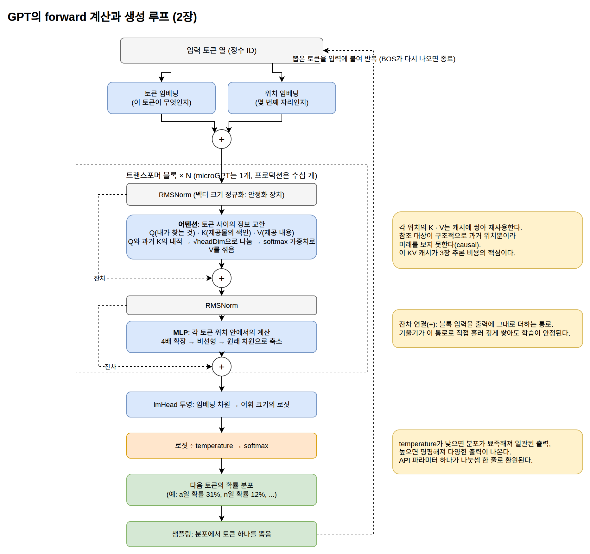
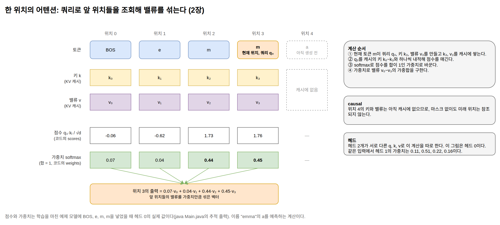
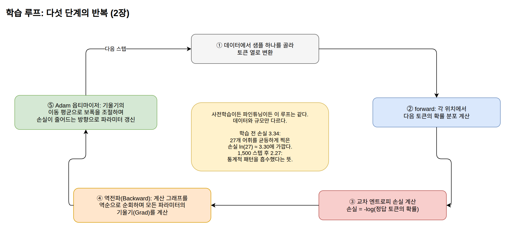

[[ch-microgpt-model]]
= GPT의 구조와 학습, 추론

== 모델 아키텍처: GPT를 이루는 부품

microGPT 모델은 GPT-2를 축소한 구조로, 토큰 임베딩, 위치 임베딩, 어텐션 블록, MLP 블록, 잔차 연결로 이루어진다. 임베딩 차원 16, 헤드 2개, 블록 1개로 파라미터는 4,192개다. 프로덕션 모델은 이 구조에서 차원과 블록 수를 키우고, 학습 안정성을 위한 정규화(이 장 뒤에서 본다)나 서빙 효율을 위한 GQA(3장) 같은 부품을 바꿔 넣는다. 부품이 바뀌어도 계산의 흐름은 같다.

.GPT의 forward 계산과 생성 루프. 각 부품은 이 장에서 차례로 다룬다

부품마다 설명에 실행한 모델의 실제 값을 붙인다. 예제는 학습을 마친 뒤(학습은 이 장의 학습 루프 절에서 다룬다) 모델에 BOS, e, m, m을 차례로 넣고, 마지막 m 다음에 올 글자를 예측하는 forward 한 번의 중간값을 출력한다. 학습 데이터의 첫 이름이 emma이므로 정답은 a다. 이 장은 그 값들을 임베딩에서 손실까지 순서대로 따라간다.

[source,java]
----
include::../examples/java/microgpt/Trace.java[tag=trace,indent=0]
----

``forward``는 토큰을 하나씩 받으므로 네 번 호출한다. 앞의 세 번은 BOS, e, m을 처리하고, 네 번째 호출이 추적 대상이다. ``model.trace``에 기록 객체를 지정해 두면 ``forward``가 어텐션의 중간값을 거기에 남긴다. 난수 시드를 고정했으므로 같은 환경에서는 실행할 때마다 아래와 같은 값이 나온다.

=== 임베딩

신경망은 정수 토큰을 그대로 다루지 못하므로 각 토큰을 학습 가능한 벡터로 바꾼다. 도입 장에서 본 대로 토큰은 번호를 거쳐 숫자 배열이 되는데, microGPT에서 그 배열은 숫자 16개다.

바꾸는 방법은 계산이 아니라 표 조회다. 토큰 임베딩 표 ``wte``는 27행 16열의 숫자 표로, 어휘의 토큰마다 행이 하나씩 있다. 토큰 번호가 12인 m의 벡터는 이 표의 12번 행 ``wte[12]``다. 위치 임베딩 표 ``wpe``는 16행 16열이고 위치마다 행이 하나씩 있다. 토큰 임베딩은 "이 문자가 무엇인지"를, 위치 임베딩은 "몇 번째 자리에 있는지"를 나타낸다. 두 행을 같은 자리의 성분끼리 더한 벡터가 첫 블록의 입력이다. 추적 출력의 첫 부분에 이 조회와 덧셈의 결과가 나온다.

----
현재 토큰 m (ID 12), 위치 3
  wte[12] = [ 0.213, -0.121, -0.132,  0.409, ...]  토큰 임베딩 16개 중 앞 4개
  wpe[3]  = [ 0.124, -0.110,  0.383,  0.213, ...]  위치 임베딩
  x       = [ 0.337, -0.230,  0.251,  0.622, ...]  두 벡터를 성분끼리 더한 값
----

첫 성분은 ``0.213 + 0.124 = 0.337``이다. 둘째 성분이 -0.231이 아니라 -0.230인 것은 세 값을 각각 소수 셋째 자리로 반올림해 출력했기 때문이다. 숫자 하나하나에 사람이 읽을 수 있는 뜻은 없다. 두 표의 숫자 688개는 다른 가중치와 똑같은 파라미터라서 처음에는 무작위 값이고, 학습이 손실을 줄이는 방향으로 조금씩 고친 결과가 위의 값이다.

어텐션 연산에는 순서 개념이 없으므로 위치 임베딩이 필요하다. "abc"와 "cba"를 구분하려면 각 토큰의 벡터에 위치 정보가 들어 있어야 한다. 이 예의 입력에는 m이 두 번 나온다. 두 m은 ``wte[12]``가 같지만 위치 임베딩이 ``wpe[2]``와 ``wpe[3]``으로 달라서, 더한 벡터 ``x``는 서로 다르다.

=== 어텐션: 토큰 사이의 정보 교환

어텐션은 시퀀스 안에서 토큰끼리 정보를 주고받는 유일한 연산이다.

각 토큰은 자신의 벡터에서 세 가지 벡터를 만든다. 쿼리(query)는 "내가 찾는 것", 키(key)는 "내가 제공하는 것의 색인", 밸류(value)는 "내가 제공하는 내용"이다. 현재 토큰의 쿼리를 앞선 토큰들의 키와 내적해서 "어느 토큰을 얼마나 참고할지" 점수(코드의 ``scores``)를 매긴다. 내적은 두 벡터의 같은 위치 성분끼리 곱해 모두 더한 값으로, 두 벡터의 방향이 비슷할수록 크다(4장). 이 점수를 softmax로 정규화한 가중치(``weights``)로 밸류들의 가중합을 구한다. 가중합은 값마다 가중치를 곱해 더한 것이다.

추적 예에서 현재 토큰은 위치 3의 m이고, 참고할 수 있는 위치는 BOS, e, m, 그리고 자기 자신인 m까지 넷이다. 두 헤드 가운데 헤드 0의 값은 다음과 같다.

----
어텐션 헤드 0 (위치 0~3의 키와 밸류를 참조)
  scores  = [-0.059, -0.622,  1.734,  1.760]
  weights = [ 0.073,  0.041,  0.437,  0.449]  합 1.000
  v[t][0] = [-1.164,  0.641,  1.024,  0.681]  각 위치 밸류의 0번 성분
  attnOut[0] = 0.073×(-1.164) + 0.041×(0.641) + 0.437×(1.024) + 0.449×(0.681) = 0.695
----

``scores``는 m의 쿼리와 네 위치의 키로 매긴 점수다. 두 m의 위치가 1.734와 1.760으로 높고, BOS와 e는 음수다. softmax는 이 점수를 합이 1인 가중치로 바꾼다. 두 m이 0.437과 0.449, 합쳐서 약 89%를 차지한다. 점수 차이가 가중치의 비율로 바뀌는 계산은 4장의 softmax 절에 있다. 마지막 두 줄은 밸류를 섞는 단계다. 네 위치의 밸류에서 0번 성분만 꺼내 가중치를 곱해 더하면 출력의 0번 성분 0.695가 나온다. BOS의 밸류 -1.164는 가중치 0.073만 곱해지므로 결과에 -0.085만 보탠다. 헤드 하나가 맡은 8개 성분 모두를 같은 가중치로 이렇게 섞는다.

이 계산을 하는 코드가 다음이다. 숫자가 ``double``이 아니라 1장의 ``Value``인 것은 학습 때 손실에서 이 계산을 거슬러 올라가 기울기를 구해야 하기 때문이다. 값만 따라갈 때는 ``mul``과 ``add``를 곱셈과 덧셈으로 읽으면 된다.

[source,java]
----
include::../examples/java/microgpt/Gpt.java[tag=attention,indent=0]
----

``matvec``은 행렬과 벡터의 곱이다. 입력 벡터에 행렬 ``attnQ``, ``attnK``, ``attnV``를 곱한 결과가 쿼리, 키, 밸류다. 헤드마다 앞의 반복문이 점수를, 뒤의 반복문이 밸류의 가중합을 계산한다. ``trace.record`` 호출은 위의 추적 값을 남기는 줄이고 계산에는 관여하지 않는다.

다음 토큰을 예측하는 모델이 정답을 미리 봐서는 안 되므로, 미래 토큰은 참조할 수 없어야 한다(causal). 이 구현은 토큰을 하나씩 처리하면서 각 위치의 키와 밸류를 캐시에 쌓는다. 현재 토큰을 처리하는 시점에는 캐시에 과거 위치만 들어 있으므로 미래 위치를 가리는 마스크가 따로 필요 없다. 키(K)와 밸류(V)를 쌓아 두는 이 캐시가 KV 캐시이고, 프로덕션 추론 엔진이 생성 속도를 높이려고 쓰는 캐시도 원리가 같다. 이 캐시가 프로덕션 추론의 속도와 비용을 어떻게 결정하는지는 3장에서 측정한다. 6장의 프롬프트 캐싱과 7장의 캐시 조작도 이 캐시를 다루는 기법이다.

토큰 사이의 관계가 한 종류가 아니므로 헤드를 여러 개 둔다. 헤드마다 쿼리, 키, 밸류의 서로 다른 8개 성분으로 점수를 따로 매긴다. 같은 입력에서 헤드 1의 값은 헤드 0과 다르다.

----
어텐션 헤드 1 (위치 0~3의 키와 밸류를 참조)
  scores  = [-0.317,  1.225,  0.373,  0.080]
  weights = [ 0.109,  0.511,  0.218,  0.162]  합 1.000
----

헤드 0이 두 m에 가중치의 89%를 준 입력에서 헤드 1은 이름의 첫 글자 e에 51%를 준다. 헤드가 여럿이면 어떤 헤드는 바로 앞 문자에, 다른 헤드는 단어의 첫 문자에 주목하는 식으로 서로 다른 의존 관계를 나눠 학습할 수 있다. 두 헤드의 출력 8개씩을 이어 붙인 16개 성분에 행렬 ``attnProj``를 곱한 것이 어텐션 블록의 출력이다.

아래 그림은 헤드 0의 계산을 한 장에 그린 것이다. 점수와 가중치는 위 출력을 소수 둘째 자리로 줄인 값이다.

.한 위치의 어텐션 계산: 쿼리, 키, 밸류와 causal 구조

=== MLP와 잔차 연결

어텐션이 토큰 사이에서 정보를 주고받는다면, MLP 블록은 어텐션이 모아 온 정보를 각 토큰 위치 안에서 가공한다. 벡터를 4배 넓은 차원(16에서 64)으로 확장하고 비선형 함수(이 구현에서는 tanh)를 통과시킨 뒤 원래 차원으로 되돌린다.

잔차 연결(residual connection)은 블록의 입력을 출력에 그대로 더하는 연결이다. 코드의 ``x[i].add(proj[i])``가 이 덧셈이다. 역전파 때 기울기가 블록 안의 연산들을 거치지 않고 이 덧셈을 따라 앞 블록으로 바로 전달되므로 블록을 깊이 쌓아도 학습이 안정된다.

전체 forward 계산은 다음과 같다. 앞 절에서 본 어텐션 코드는 주석 표시 자리에 들어간다.

[source,java]
----
include::../examples/java/microgpt/Gpt.java[tags=forward;!attention,indent=0]
----

마지막의 `lmHead` 투영이 임베딩 차원의 벡터를 어휘 크기(27)의 로짓으로 바꾼다. 이 로짓이 1장에서 말한 "다음 토큰의 확률 분포"의 재료다. 추적 예의 로짓 27개 가운데 큰 것 다섯 개와, 로짓 전체를 softmax로 바꾼 확률은 다음과 같다.

----
로짓 상위 5개와 softmax 확률
  a   로짓  0.862  확률 0.232
  i   로짓  0.816  확률 0.221
  e   로짓  0.657  확률 0.189
  y   로짓 -0.211  확률 0.079
  l   로짓 -0.329  확률 0.070
----

모델은 emm 다음 글자로 a에 가장 높은 확률 23%를 주고, i와 e에도 비슷한 확률을 준다. 학습 데이터 2,000개 가운데 emm으로 시작하는 이름은 12개이고, 그다음 글자는 a가 6번(emma, emmalyn 등), e가 3번(emmeline 등), i가 2번(emmie, emmi), y가 1번(emmy)이다. 모델이 상위에 올린 네 글자가 데이터에 실제로 나온 네 글자와 같다. 다만 확률은 6:3:2:1의 비율과 같지 않다. 파라미터 4,192개로는 이 열두 이름을 따로 외울 수 없고, 모델은 이름 2,000개 전체에서 배운 통계로 답한다.

=== 정규화와 스케일링: 학습을 안정시키는 장치

앞의 코드에서 아직 설명하지 않은 부품은 ``rmsnorm`` 호출과 어텐션 점수에 ``invSqrt``를 곱하는 부분이다. 둘 다 표현력을 늘리는 부품이 아니라 학습을 안정시키는 장치다.

``rmsnorm``은 벡터의 각 성분을 제곱 평균의 제곱근으로 나눠 크기를 일정하게 유지한다. 제곱 평균의 제곱근은 성분들을 제곱해 평균 낸 뒤 제곱근을 취한 값으로, 성분들의 대표 크기다. 예를 들어 [3, 4]는 이 값이 약 3.54이고, 나누면 [0.85, 1.13]이 된다. 블록을 지나며 벡터 크기가 계속 커지거나 작아지면 역전파되는 기울기도 함께 폭주하거나 소멸한다. 어텐션과 MLP에 들어가기 직전, 그리고 마지막 ``lmHead`` 투영 직전에 크기를 맞추면 이 문제가 완화된다. RMSNorm은 원조 트랜스포머의 LayerNorm에서 평균 빼기를 생략해 단순화한 것으로, Llama 계열을 비롯한 최근 모델 대부분이 쓴다.

어텐션 점수를 ``headDim``의 제곱근으로 나누는 것도 목적이 같다. 내적은 성분끼리의 곱을 차원 수만큼 더한 값이라서, 차원이 클수록 값의 폭이 커진다(4장에서 계산하듯 폭은 차원의 제곱근에 비례한다). 점수가 너무 커지면 softmax가 한 토큰에 확률을 몰아주는 극단적인 분포가 되고, 기울기가 거의 0이 되어 학습이 정체된다. 제곱근으로 나눠 점수 크기를 차원과 무관하게 유지하는 것이 scaled dot-product attention의 "scaled"다.

프로덕션 모델의 아키텍처 명세에 나오는 생소한 이름(RMSNorm, QK-norm 등) 상당수가 이처럼 수치가 다루기 좋은 범위를 벗어나지 않게 제한하는 장치다. 새 이름을 만나면 "표현력의 부품인가, 안정화 장치인가"부터 구분하면 이해가 빨라진다.

== 학습 루프

학습은 다음 다섯 단계의 반복이다.

1. 데이터셋에서 이름 하나를 골라 토큰 열로 바꾼다.
2. 모델에 순서대로 넣어 각 위치에서 다음 토큰의 확률 분포를 얻는다.
3. 정답 토큰의 확률로 교차 엔트로피 손실 ``-log(정답 토큰의 확률)``을 계산한다. 정답에 확률 1을 주면 손실 0, 확률을 낮게 주면 손실이 커진다(확률 0.5면 약 0.69, 0.01이면 약 4.61).
4. 역전파로 모든 파라미터의 기울기를 얻는다.
5. 옵티마이저로 파라미터를 손실이 줄어드는 방향으로 조금씩 움직인다.

앞의 추적 예는 이 가운데 2단계와 3단계를 한 위치에서 본 것이다. 1단계에서 이름 emma를 고르면 토큰 열은 BOS, e, m, m, a, BOS가 되고, 위치 3의 정답은 a다. 2단계의 forward가 내놓은 분포에서 a의 확률이 0.232였으므로 3단계의 손실은 다음과 같다.

----
정답 a: 확률 0.232, 손실 -ln(0.232) = 1.46
----

학습 중이라면 이 값을 나머지 네 위치의 손실과 함께 평균한 것이 그 스텝의 손실이다. 4단계의 역전파는 그 손실에서 출발해 로짓, 어텐션의 가중합과 점수, 임베딩 표의 ``wte[12]``까지 거슬러 올라가며 파라미터 4,192개 각각의 기울기를 구한다. 5단계에서 옵티마이저가 그 기울기의 반대 방향으로 파라미터를 고치면, 같은 입력에서 a의 확률이 조금 오른다.

.학습 루프: 다섯 단계의 반복

[source,java]
----
include::../examples/java/microgpt/Main.java[tag=training,indent=0]
----

옵티마이저는 Adam이다. 단순 경사 하강법은 기울기에 학습률을 곱해 바로 빼지만, Adam은 기울기의 이동 평균(1차 모멘트)과 기울기 제곱의 이동 평균(2차 모멘트)으로 파라미터마다 이동 폭을 따로 조절한다. 이동 평균은 새 값을 조금씩 섞어 넣으며 최근 값들의 평균을 따라가는 값이다. 기울기가 요동치는 파라미터는 조금, 꾸준한 파라미터는 크게 움직여 학습이 빠르고 안정된다. 갱신식과 첫 스텝의 계산은 4장의 Adam 절에 있다.

학습 전 손실은 약 3.34다. 우연한 값이 아니라 27개 어휘 중 하나를 균등하게 찍었을 때의 손실 ``ln(27) ≈ 3.296``에 가깝다. 27개 토큰에 똑같이 확률 1/27을 주면 손실이 ``-log(1/27)``, 곧 ``ln(27)``이기 때문이다. 초기화 직후의 모델은 아무것도 모르므로 균등 추측과 성적이 같다. 1,500 스텝을 학습하면 손실이 2.27 근처까지 내려간다. 모델이 "m 다음에는 a가 자주 온다", "이름은 대체로 모음과 자음이 교대한다" 같은 통계를 학습했다는 뜻이다.

이 작은 학습 루프가 5장에서 다룰 학습 기법들의 공통 형태다. 사전학습, 미세조정, 선호 학습은 데이터와 손실 함수만 다르고 "손실을 계산하고, 역전파하고, 파라미터를 갱신한다"는 루프는 같다. 여러 모델의 가중치를 평균 내는 병합처럼 학습 없이 가중치를 연산하는 기법만 이 루프 밖에 있다.

== 추론: 확률 분포에서 샘플링

학습이 끝난 모델로 새 이름을 만들 때는 BOS 토큰으로 시작해 모델이 내놓은 다음 토큰 확률 분포에서 하나를 뽑고, 그 토큰을 입력에 붙여 다시 예측한다. BOS가 다시 나오면 이름이 완성된다.

[source,java]
----
include::../examples/java/microgpt/Main.java[tag=sampling,indent=0]
----

로짓을 temperature 파라미터로 나눈 뒤 softmax를 취하면 분포의 모양이 바뀐다. 1보다 작으면 분포가 뾰족해져 확률 높은 토큰이 더 자주 뽑히고, 1보다 크면 평평해져 의외의 토큰도 뽑힌다. 예제는 ``softmaxData``에 temperature 0.8을 넘겨 분포를 조금 뾰족하게 만든다. 도입 장의 요청에 있던 `temperature` 필드가 코드에서는 이 나눗셈 한 번이다.

실행하면 다음과 같은 이름이 생성된다. 데이터셋에 없는 새 이름이지만 영어 이름의 통계적 특징을 갖췄다.

----
abrilia, arialy, aranna, maley, telin, ...
----

== microGPT와 프로덕션 LLM

[cols="1,2,2"]
|===
| 구분 | microGPT | 프로덕션 LLM

| 파라미터 수
| 4,192개
| 수백억에서 수조 개

| 학습 데이터
| 이름 수천 개
| 수조 토큰의 웹 문서, 책, 코드

| 토크나이저
| 문자 단위, 어휘 27개
| BPE, 어휘 3만~25만 개

| 하드웨어
| CPU에서 실행, 수십 초
| GPU/TPU 클러스터, 수개월

| 학습 단계
| 사전학습만
| 사전학습 + 미세조정 + 선호 학습 (5장)
|===

표의 어느 항목도 동작 원리를 바꾸지 않는다. 프로덕션 LLM도 다음 토큰의 확률 분포를 예측하고, 교차 엔트로피 손실을 역전파로 줄이고, 추론 시 분포에서 샘플링한다.

따라서 모델은 진실을 이해하지 않고 통계적으로 그럴듯한 토큰 열을 생성할 뿐이다. microGPT가 만든 "abrilia"가 실존 인물과 무관하듯, LLM이 생성한 문장도 사실 여부와 무관하게 "그럴듯함"을 기준으로 만들어진다. 사실이 아닌 내용을 그럴듯하게 만들어 내는 환각(hallucination)도 여기서 비롯된다. 학습의 목표는 그럴듯한 문장과 사실인 문장이 대체로 겹치게 하는 것이지만, 원리상 둘이 완전히 일치할 수는 없다.

그래서 정확한 답이 필요한 시스템은 모델의 내부 지식에만 의존하지 않고 외부에서 근거를 공급한다. 대표적인 구조가 4부에서 다룰 RAG다. microGPT는 CPU에서 이름 하나를 순식간에 만들지만, 프로덕션 규모의 같은 추론은 GPU 메모리와 시간을 대량으로 쓴다. RAG에 앞서 다음 장에서 그 비용 구조가 어디서 나오는지 측정한다.
