[[ch-math-stats]]
= 코드 뒤의 수학

== 이 장을 읽는 방법

1부의 앞 세 장은 수식 대신 실행되는 코드로 원리를 설명한다. 그 코드 뒤의 수학 개념을 알면 코드가 왜 그렇게 생겼는지가 분명해진다. 손실이 왜 ``-log(확률)``인지, 어텐션 점수를 왜 ``sqrt(headDim)``으로 나누는지, temperature가 분포의 모양을 왜 그렇게 바꾸는지가 모두 수학 한두 줄로 설명된다. 이 장은 그 개념들을 증명 없이 한곳에 모으고, 각 개념이 이어지는 장을 함께 적었다.

이 장은 책에서 가장 먼저 읽어도 된다. 다른 장의 코드와 용어를 가리키는 문장이 많지만, 그 장을 읽지 않았어도 뜻이 통하도록 필요한 말은 그 자리에서 풀이했다. 벡터, 확률, 로그, 미분이 낯선 독자는 이 장을 먼저 읽고, 그렇지 않은 독자는 앞 장을 읽다가 개념이 나올 때 해당 절을 찾아 읽으면 된다.

다루는 개념 대부분은 고등학교 수학(벡터, 미분, 지수와 로그, 확률과 통계)의 연장이라서, 절마다 이어지는 고등학교 수학 내용도 밝힌다. 그 내용이 기억나지 않아도 읽을 수 있도록 식마다 바로 뒤에 숫자를 넣은 계산을 둔다. 식이 낯설면 숫자 계산부터 읽고 식으로 돌아오면 된다.

식은 수학 조판 대신 코드에 가까운 표기로 쓴다. 자주 나오는 표기는 다음 표와 같고, 각 표기는 처음 나오는 절에서 다시 설명한다. 로그는 모두 밑이 e(약 2.718)인 자연로그(`ln`)를 쓴다.

[cols="1,3"]
|===
| 표기 | 읽는 법

| `a * b`, `a / b`
| 곱셈과 나눗셈

| `a^n`
| a의 n제곱. 지수가 음수인 ``a^(-n)``은 ``1 / a^n``이다

| `sqrt(x)`
| x의 제곱근. `sqrt(9) = 3`

| `exp(x)`
| e의 x제곱. `exp(0) = 1`, `exp(1) ≈ 2.718`

| `ln(x)`, `log(x)`
| 자연로그. e를 몇 제곱해야 x가 되는지를 뜻하며 ``exp``의 역연산이다. `ln(1) = 0`

| `Σ`
| 뒤따르는 항을 모두 더한다. 코드에서 반복문으로 합계를 구하는 것과 같다

| `x_i`
| 배열 x의 i번째 성분. 코드의 `x[i]`

| `\|a\|`
| 벡터 a의 길이

| `x̄`, `σ`
| 평균과 표준편차

| `P(A \| B)`
| B가 주어졌을 때 A일 확률

| `Δ`
| 두 값의 차이 또는 변화량

| `∂f/∂x`, `dy/dx`
| x가 조금 변할 때 f(또는 y)가 변하는 비율

| `≈`
| 거의 같다. 반올림한 값에 쓴다
|===

설명 순서는 2장 학습 루프를 따른다. 앞의 네 절은 모델이 다루는 벡터와 행렬(forward), 모델이 내놓는 확률 분포(출력), 그 분포를 채점하는 손실(로그와 정보량), 손실을 줄이는 방향을 알아내는 미분(역전파와 옵티마이저)이다. 마지막 절은 층을 거치는 값의 규모를 관리하는 평균과 분산이다. 이 다섯 절이 microGPT 두 장과 추론 서빙 장을 읽는 데 필요한 수학이다.

정규 분포, 주성분 분석, 회귀, 마르코프 체인, 유의성 검정처럼 이 책의 다른 장이 참조하는 통계 개념은 부록 통계 참고에 따로 두었다. 그 절들은 본문이 가리킬 때 찾아 읽으면 된다.

[cols="2,4,3"]
|===
| 절 | 개념 | 이어지는 장

| 벡터와 행렬
| 내적, 코사인 유사도, 행렬 곱, 랭크와 저랭크 근사
| 2장 임베딩과 어텐션, 3장 추론 비용, 7장 LoRA, 11장 벡터 검색

| 확률
| 확률 분포, 조건부 확률, 베이즈 정리, softmax, temperature, 샘플링
| 1장과 2장의 다음 토큰 예측, 7장 디코딩 제어, 11장 BM25

| 로그와 정보량
| 최대 우도, 교차 엔트로피, 엔트로피, perplexity, KL 발산
| 2장 학습 루프, 5장 증류와 RLHF

| 미분
| 도함수, 그래디언트, 체인 룰, 경사 하강법, Adam
| 1장 자동 미분, 2장 옵티마이저

| 평균과 분산
| 평균, 분산, 표준편차, 정규화
| 2장 RMSNorm과 어텐션 점수의 스케일링
|===

== 벡터와 행렬: 모델이 다루는 표현

=== 벡터와 내적

**벡터**는 숫자를 나열한 배열이다. 코드에서는 ``[0.2, -1.3, 0.7]``처럼 float 배열 하나지만, 기하학적으로는 고차원 공간의 좌표다. 2장의 임베딩이 이것이다. 토큰 하나를 수백 차원 공간의 한 좌표로 나타내고, 의미가 비슷한 토큰이 가까운 좌표에 놓이도록 학습한다. 11장의 벡터 검색도 텍스트를 좌표로 바꿔 두고 질의와 가까운 문서를 찾는다.

*내적*(dot product)은 두 벡터의 같은 위치 성분끼리 곱해서 모두 더한 값이다.

----
a = [1, 2], b = [3, 4]
a·b = 1*3 + 2*4 = 11
----

코드로는 반복문 하나다. 두 배열을 같은 인덱스로 순회하며 ``sum {plus}= a[i] * b[i]``를 누적한 값이고, 결과는 벡터가 아니라 숫자 하나다. 고등학교 기하에서 배운 내적과 같은 연산이며, 차원이 2, 3에서 수백으로 늘었을 뿐이다.

내적은 두 벡터의 방향이 비슷할수록 커지고, 수직이면 0, 반대 방향이면 음수다. 가로축 방향의 벡터 [1, 0]과 세 벡터의 내적을 계산하면 다음과 같다.

----
[1, 0]·[2, 1]  = 1*2 + 0*1    =  2    비슷한 방향: 양수
[1, 0]·[0, 3]  = 1*0 + 0*3    =  0    수직: 0
[1, 0]·[-2, 1] = 1*(-2) + 0*1 = -2    반대쪽 방향: 음수
----

이 성질은 고등학교에서 배운 내적의 다른 정의에서 나온다. 내적은 두 벡터의 길이 ``|a|``, ``|b|``와 사잇각 θ(세타)의 코사인을 곱한 값(``a·b = |a| * |b| * cos θ``)이기도 하다. 코사인은 각이 0도일 때 1, 90도일 때 0, 180도일 때 -1인 함수라서, 길이가 같다면 방향이 가까울수록 내적이 크고 수직이면 0, 반대면 음수가 된다. 두 정의가 같은 값을 내므로 성분끼리 곱해 더하는 계산만으로 사잇각을 알 수 있다. 그래서 내적은 "얼마나 비슷한가"를 재는 가장 기본적인 도구가 된다. 2장의 어텐션이 이 도구를 쓴다. 어텐션은 지금 위치의 토큰이 앞의 어느 토큰을 얼마나 참고할지 점수를 매기는 연산이다. 그 점수가 쿼리 벡터와 키 벡터라는 두 벡터의 내적이고, 쿼리와 방향이 비슷한 키일수록 높은 점수를 받는다.

.벡터와 내적. 내적의 부호와 크기는 두 벡터의 사잇각이 정한다
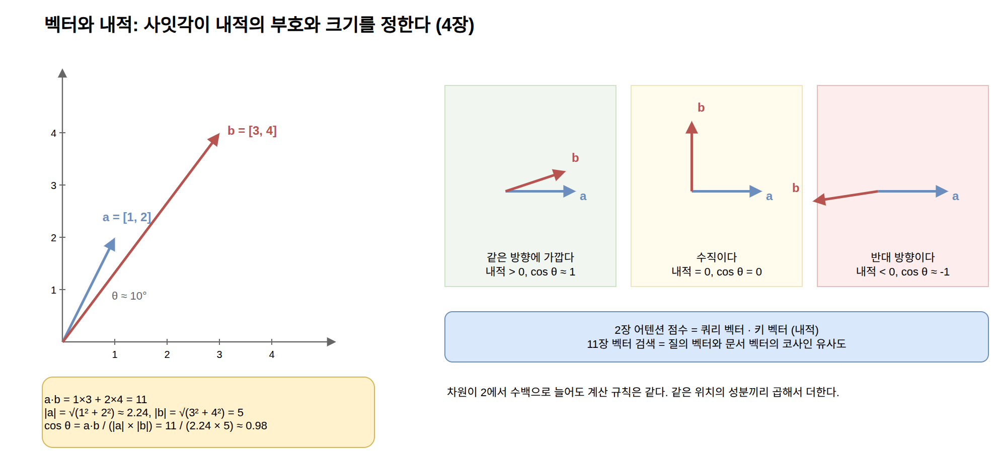

=== 코사인 유사도

**코사인 유사도**는 내적을 두 벡터의 길이로 나눈 값, 곧 사잇각의 코사인이다. 앞 절의 식 ``a·b = |a| * |b| * cos θ``의 양변을 두 길이로 나눈 것이다. 벡터의 길이 ``|a|``는 각 성분을 제곱해 더한 값의 제곱근으로, 직각삼각형의 빗변을 구하는 피타고라스 정리를 d차원으로 늘린 것이다.

----
|a| = sqrt(1² + 2²) ≈ 2.236,  |b| = sqrt(3² + 4²) = 5

cos(a, b) = a·b / (|a| * |b|)
          = 11 / (2.236 * 5) ≈ 0.98
----

위 예의 두 벡터는 사잇각이 약 10도라서 코사인이 1에 가깝다.

길이로 나누는 이유는 내적이 방향뿐 아니라 길이에도 좌우되기 때문이다. b를 두 배로 늘린 [6, 8]은 방향이 b와 같지만 a와의 내적은 22로 두 배가 된다. 길이도 10으로 두 배가 되므로 코사인 유사도는 ``22 / (2.236 * 10) ≈ 0.98``로 그대로다. 길이로 나누면 크기는 무시되고 방향만 비교되므로 값이 항상 -1에서 1 사이다. 1이면 같은 방향, 0이면 수직, -1이면 정반대 방향이다. 긴 문서든 짧은 질의든 같은 범위의 값으로 비교할 수 있어서 11장의 벡터 검색이 이것을 쓴다.

벡터의 길이를 미리 1로 맞춰 두면(정규화) 코사인 유사도는 내적과 같다. 각 성분을 벡터의 길이로 나누면 길이가 1이 된다.

----
a / |a| = [1 / 2.236, 2 / 2.236] ≈ [0.447, 0.894]
b / |b| = [3 / 5, 4 / 5]         = [0.6, 0.8]

내적 = 0.447*0.6 + 0.894*0.8 ≈ 0.98    (위의 코사인 유사도와 같은 값)
----

그래서 많은 임베딩 모델이 길이 1인 벡터를 내놓고, Vector DB는 내적만 계산해도 코사인 유사도를 얻는다.

=== 행렬: 벡터를 다른 벡터로 바꾸는 변환

**행렬**은 벡터를 다른 벡터로 바꾸는 변환이다. 코드에서는 2차원 배열이고, m×d 행렬은 행(가로줄)이 m개, 열(세로줄)이 d개라는 뜻이다. 행렬 곱 한 번은 입력 벡터의 각 성분을 서로 다른 가중치로 섞어 새 벡터를 만든다. 2×2 행렬로 확인하면 다음과 같다.

----
W = [[2, 0],      x = [1, 2]
     [1, 1]]

Wx = [2*1 + 0*2,   = [2,
      1*1 + 1*2]      3]
----

출력의 각 성분은 행렬의 한 행을 가중치로 삼은 입력 성분들의 가중합(값마다 가중치를 곱해 더한 합), 곧 그 행과 입력 벡터의 내적이다. 위 예에서 출력의 첫 성분 2는 첫 행 [2, 0]과 x의 내적이고, 둘째 성분 3은 둘째 행 [1, 1]과 x의 내적이다. 입력이 d차원, 출력이 m차원이면 행렬은 m×d 크기이고 곱셈은 m×d번이다. 신경망의 한 층은 이 행렬 곱에 비선형 함수(tanh처럼 그래프가 직선이 아닌 함수)를 붙인 것이다. 2장에서 임베딩 차원의 벡터를 어휘 크기의 로짓(토큰마다 하나씩 매긴 점수)으로 바꾸는 `lmHead` 투영이 행렬 곱 하나이고, 어텐션의 쿼리·키·밸류도 각각 행렬 곱으로 만든다.

비선형 함수가 필요한 이유도 이 계산 규칙에서 나온다. 행렬 곱 두 개를 이은 ``W2(W1 x)``는 두 행렬을 먼저 곱한 행렬 ``(W2 W1)``을 x에 곱한 것과 같다.

----
W1 = [[2, 0],   W2 = [[1, 1],   W2 W1 = [[3, 1],
      [1, 1]]         [0, 2]]            [2, 2]]

x = [1, 2]이면  W1 x = [2, 3],  W2 (W1 x) = [5, 6],  (W2 W1) x = [5, 6]
----

두 행렬의 곱 ``W2 W1``의 각 성분은 W2의 행과 W1의 열의 내적이다. 예를 들어 첫 행 첫 열의 3은 W2의 첫 행 [1, 1]과 W1의 첫 열 [2, 1]의 내적 ``1 * 2 + 1 * 1``이다. x에 W1과 W2를 차례로 곱한 결과와 미리 곱해 둔 ``W2 W1``을 한 번 곱한 결과가 [5, 6]으로 같다.

그러므로 행렬 곱만 아무리 쌓아도 결과는 행렬 곱 한 번이고, 층을 늘려도 표현력이 늘지 않는다. 층 사이에 직선이 아닌 함수를 끼워야 앞 층의 출력을 구부리거나 잘라 낼 수 있고, 층을 쌓는 의미가 생긴다. 2장 MLP 블록의 두 행렬 곱 사이에 있는 ``tanh``가 이 자리이고, 프로덕션 모델의 GELU나 SwiGLU도 같은 역할이다.

.비선형 함수의 역할. 행렬 곱만 이으면 직선 하나로 합쳐지고, 사이에 tanh를 끼우면 구부러진 곡선이 된다
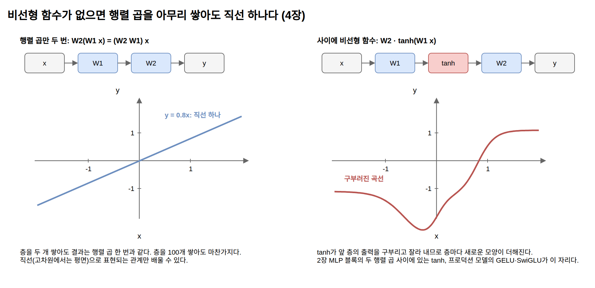

LLM의 파라미터 대부분은 이런 행렬들의 성분이고, 추론 계산 대부분도 행렬 곱이다. GPU는 행렬 곱을 대규모로 병렬 처리하는 장치라서 LLM에 필수다. 3장의 추론 비용 구조도 "행렬 곱에 필요한 데이터를 메모리에서 얼마나 실어 나르는가"의 문제다. 출력 토큰을 하나씩 생성하는 디코드 단계에서는 토큰 하나를 만들 때마다 모델의 모든 행렬을 한 번씩 읽지만 각 행렬로 하는 일은 벡터 하나와의 곱뿐이라, 연산보다 읽기가 병목이 된다.

벡터 여러 개를 한꺼번에 변환하면 행렬과 행렬의 곱이 된다. 토큰 T개의 쿼리 벡터를 행으로 쌓은 T×d 행렬 Q와 키 벡터를 쌓은 K를 곱한 ``Q Kᵀ``는 T×T 행렬이고, 그 (i, j) 성분이 i번째 쿼리와 j번째 키의 내적, 곧 어텐션 점수다. ``Kᵀ``는 K의 행과 열을 맞바꾼 전치 행렬(transpose)로, T×d인 K를 d×T로 바꾼 것이다. 행렬 곱은 앞 행렬의 열 수와 뒤 행렬의 행 수가 같아야 하므로 K를 이렇게 바꿔서 곱한다.

----
프리필: 점수 행렬 = Q Kᵀ / sqrt(d)    (T×d 곱하기 d×T = T×T)
디코드: 점수 벡터 = q Kᵀ / sqrt(d)    (1×d 곱하기 d×T = 1×T)
----

입력 토큰 전체를 한 번에 처리하는 3장의 프리필이 위의 행렬 곱이고, 디코드는 새 토큰의 쿼리 하나만 있으므로 아래의 벡터와 행렬의 곱이다. 계산량은 프리필이 T배 많지만 읽어야 하는 K는 같다. K의 성분 하나를 읽어 올 때마다 프리필은 곱셈을 T번, 디코드는 한 번 한다. 같은 데이터를 읽고도 프리필은 연산이, 디코드는 읽기가 병목이 되는 3장의 비대칭이 여기서 나온다.

.프리필의 행렬×행렬과 디코드의 벡터×행렬. 읽는 K는 같은데 곱셈 횟수는 T배 차이가 난다
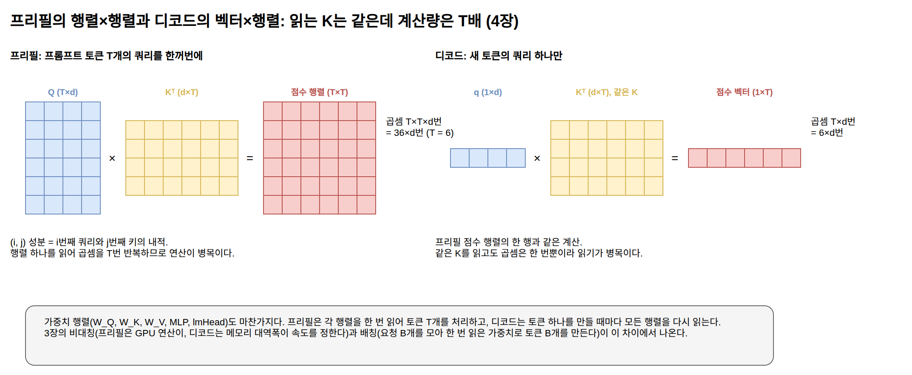

=== 랭크와 저랭크 근사

행렬의 *랭크*(rank)는 그 행렬이 담은 독립적인 방향의 수다. 각 행을 벡터로 볼 때 다른 행들의 가중합으로 만들 수 없는 행의 개수다.

----
W = [[1, 2],     둘째 행이 첫째 행의 2배이므로 랭크 1
     [2, 4]]

W = [1] × [1, 2] = [[1*1, 1*2],    (2×1 행렬과 1×2 행렬의 곱으로 정확히 복원된다)
    [2]             [2*1, 2*2]]
----

둘째 행에는 새 정보가 없으므로 "기준이 되는 행 [1, 2]"와 "각 행이 그 행의 몇 배인지 [1, 2]"만 저장해도 행렬 전체를 되살릴 수 있다. 이 2×2 행렬은 원래 숫자 4개, 분해한 뒤에도 2개와 2개를 합쳐 4개라서 저장 공간의 이득이 없다. 크기가 커지면 달라진다. d×d 행렬이라도 랭크가 r이면 d×r 행렬과 r×d 행렬의 곱으로 정확히 표현된다. 저장할 숫자가 d²개에서 2dr개로 줄어드므로 r이 d보다 훨씬 작으면 큰 압축이 된다. d가 4,096이고 r이 8이면 약 1,677만 개(4,096의 제곱)가 6만 5천 개(``2 * 4,096 * 8 = 65,536``)로, 원래의 0.4%가 된다. 랭크가 정확히 낮지 않아도 "거의 낮은" 행렬은 이런 곱으로 근사할 수 있는데, 이것이 *저랭크 근사*(low-rank approximation)다.

.저랭크 근사. d×d 행렬을 d×r과 r×d 두 행렬의 곱으로 대신하면 저장할 숫자가 d²개에서 2dr개로 줄어든다
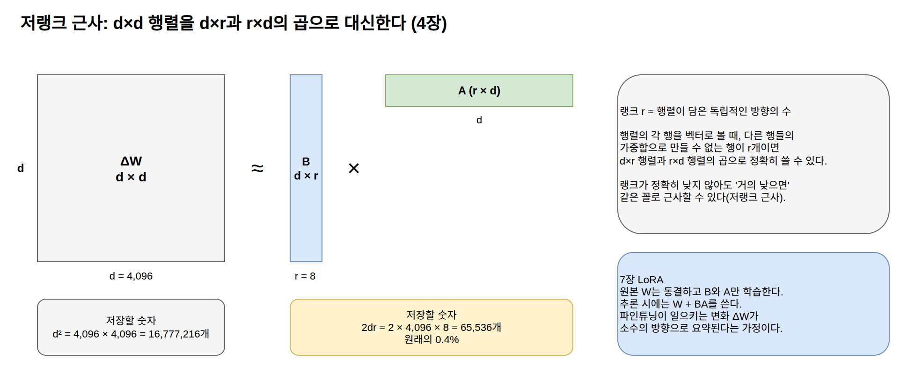

저랭크 근사를 직접 쓰는 기법이 7장의 LoRA다. 파인튜닝으로 바뀐 가중치에서 원래 가중치를 뺀 행렬이 변화량 ΔW다. LoRA는 이 ΔW를 통째로 학습하는 대신 d×r 행렬 B와 r×d 행렬 A의 곱 B×A로 근사한다. "파인튜닝이 모델에 일으키는 변화는 소수의 방향으로 요약된다"는 가정이 실제로 성립해서, 학습 파라미터를 전체의 1% 아래로 줄여도 효과가 유지된다. 데이터에서 "소수의 중요한 방향"을 통계적으로 찾는 주성분 분석은 부록 통계 참고의 데이터의 구조 절에서 다룬다.

== 확률: 모델이 내놓는 출력

=== 확률 분포와 조건부 확률

**확률 분포**는 일어날 수 있는 모든 경우에 확률을 배정한 것으로, 전체 합이 1이다. LLM의 출력이 이것이다. 모델은 매 위치에서 어휘의 모든 토큰에 확률을 하나씩 배정한다. 어휘가 27개인 microGPT라면 항목이 27개인 이산 확률 분포(경우를 하나씩 셀 수 있는 분포)가 나온다. 코드에서는 합이 1인 길이 27의 double 배열이다.

*조건부 확률* ``P(A | B)``는 "B가 주어졌을 때 A일 확률"이다. 조건이 붙으면 따져 볼 경우의 범위가 좁아진다. 이름 100개 가운데 e로 시작하는 이름이 10개이고, 그 10개 가운데 둘째 글자가 m인 이름이 4개라고 하자. 첫 글자가 e일 확률 P(e)는 10/100 = 0.1이다. 첫 글자가 e일 때 둘째 글자가 m일 조건부 확률 P(m | e)는 100개가 아니라 e로 시작하는 10개 가운데 4개이므로 0.4다.

언어 모델은 이 조건부 확률로 정의된다.

----
P(다음 토큰 | 지금까지의 토큰들)
----

A와 B가 함께 일어날 확률은 ``P(A) * P(B | A)``다(곱의 법칙). 위의 예에서 "em"으로 시작하는 이름은 100개 가운데 4개, 곧 0.04이고, 이 값은 ``P(e) * P(m | e) = 0.1 * 0.4``와 같다. 이 법칙을 토큰마다 거듭 적용하면 문장 전체의 확률은 조건부 확률들의 곱으로 분해된다.

----
P(토큰1, 토큰2, 토큰3) = P(토큰1) * P(토큰2 | 토큰1) * P(토큰3 | 토큰1, 토큰2)
----

그래서 "다음 토큰 예측" 하나만 잘하면 문장 전체에 확률을 매길 수 있고, 2장의 생성 루프처럼 토큰을 하나씩 이어 붙이기만 해도 텍스트가 생성된다.

초기의 통계적 언어 모델(n-gram)은 이 조건부 확률을 말뭉치에서 직접 세어 표로 만들었다. 직전 두세 개 토큰까지만 조건으로 삼았고, 표에 없는 조합에는 답하지 못했다. 신경망 언어 모델은 이 표를 함수로 대체한다. 학습으로 파라미터에 담은 패턴으로 확률을 계산하므로 학습 데이터에 없던 조합에도 그럴듯한 분포를 내놓는다.

=== 베이즈 정리와 나이브 베이즈

**베이즈 정리**는 조건부 확률의 방향을 뒤집는 공식이다.

----
P(A | B) = P(B | A) * P(A) / P(B)
----

"결과를 보고 원인의 확률을 갱신한다"고 읽는다. 관찰하기 쉬운 방향의 확률 P(B|A)로 알고 싶은 방향의 확률 P(A|B)를 계산한다. 전체 메일의 20%가 스팸이고, 스팸의 50%에 "무료"라는 단어가 나오며, 정상 메일에서는 5%에만 나온다고 하자. "무료"가 들어 있는 메일이 스팸일 확률은 다음과 같다.

----
P(스팸 | 무료) = P(무료 | 스팸) * P(스팸) / P(무료)
              = 0.5 * 0.2 / (0.5 * 0.2 + 0.05 * 0.8)
              = 0.10 / 0.14 ≈ 0.71
----

분모의 P(무료)는 "무료"가 든 메일 전체의 비율로, 스팸이면서 "무료"가 든 경우(``0.5 * 0.2``)와 정상이면서 "무료"가 든 경우(``0.05 * 0.8``)를 더한 것이다. 확률 대신 메일 1,000통의 개수로 세면 같은 계산이 나눗셈 한 번이 된다.

----
스팸 200통 가운데 "무료"가 든 메일: 200 * 0.5  = 100통
정상 800통 가운데 "무료"가 든 메일: 800 * 0.05 =  40통

"무료"가 든 140통 가운데 스팸은 100통  →  100 / 140 ≈ 0.71
----

단어 하나를 관찰했을 뿐인데 스팸일 확률이 20%에서 71%로 갱신되었다. 이 책에서 이 정리를 쓰는 곳은 검색이다. 11장에서 다룰 BM25의 배경인 확률적 검색 모형은 "이 문서가 질의와 관련 있을 확률"을 베이즈 정리로 추정하고, 흔한 단어의 점수를 깎는 IDF의 로그식은 그 유도 과정에서 나온 항이다. LLM의 다음 토큰 예측은 베이즈 정리를 명시적으로 쓰지 않지만 조건부 확률이라는 같은 개념으로 서술된다.

베이즈 정리를 텍스트 분류에 적용한 고전이 *나이브 베이즈*(naive Bayes)다. "이 텍스트가 스팸일 확률"을 베이즈 정리로 뒤집어 P(단어들|스팸)과 P(스팸)의 곱으로 계산한다. 이때 클래스(스팸이나 정상처럼 나눌 범주)만 주어지면 단어들이 서로 독립이라고 가정한다(이 과감한 가정이 naive라는 이름의 유래다). 그러면 P(단어들|클래스)가 단어별 확률의 곱이 되고, 실제 계산에서는 로그 확률의 합이 된다. 예를 들어 스팸에 "무료"가 나올 확률이 0.5, "당첨"이 나올 확률이 0.3이면, 두 단어가 함께 든 메일의 P(단어들|스팸)을 ``0.5 * 0.3 = 0.15``로 계산한다.

LLM, n-gram과 나란히 놓으면 차이가 분명하다. LLM은 앞의 모든 토큰을 조건으로 삼고, n-gram은 직전 두세 개만 남기고, 나이브 베이즈는 순서와 문맥을 전부 버리고 단어의 존재만 센다. 같은 곱의 법칙 위에서 조건을 얼마나 유지하느냐의 차이다.

BM25의 배경 모형도 관련성만 주어지면 문서의 단어들이 독립이라는, 나이브 베이즈와 같은 가정 위에서 유도된다. LLM 이전에 스팸 필터 같은 텍스트 분류를 도맡았던 것이 이 분류기다. 12장이 "쿼리 처리는 작고 빠른 모델"에 맡긴다고 하는 분류 작업을 LLM 이전에는 이런 분류기가 했다.

.조건을 얼마나 유지하는가. LLM은 앞의 모든 토큰을, n-gram은 직전 두 토큰만, 나이브 베이즈는 순서 없는 단어 집합만 조건으로 삼는다
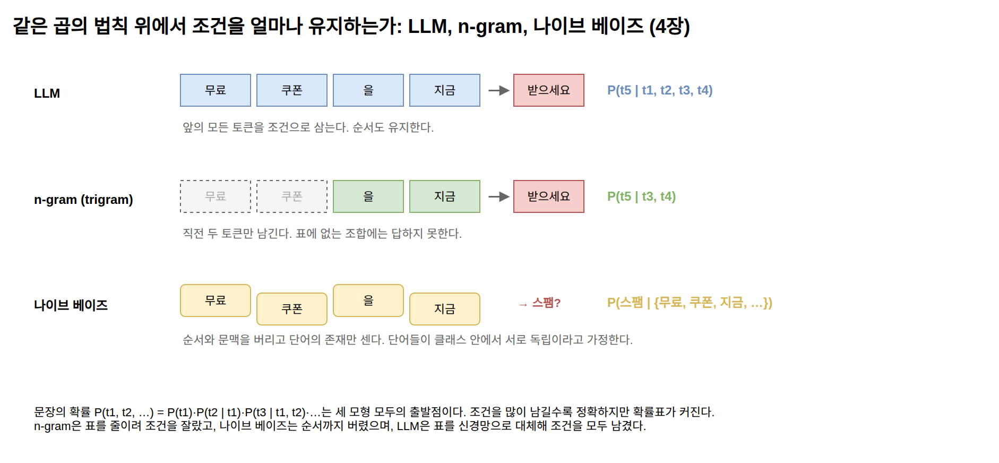

=== 로짓, softmax, temperature

모델의 마지막 행렬 곱이 내놓는 것은 확률이 아니라 *로짓*(logit)이다. 로짓은 제약 없는 실수 점수라서 음수일 수도 있고 합이 1도 아니다. 이것을 확률 분포로 바꾸는 함수가 **softmax**다. 각 점수에 지수 함수를 적용하고 전체 합으로 나눈다. 지수 함수 ``exp(x)``는 e(약 2.718)의 x제곱이다. x가 음수여도 결과는 양수이고, x가 1 커질 때마다 값이 약 2.718배가 된다.

----
softmax(z)_i = exp(z_i) / Σ_j exp(z_j)

로짓:    [2.0, 1.0, 0.1]
exp:     [7.39, 2.72, 1.11]   (합 11.21)
softmax: [7.39 / 11.21, 2.72 / 11.21, 1.11 / 11.21]
       = [0.66, 0.24, 0.10]   (합 1.0)
----

z_i는 i번째 토큰의 로짓이고, Σ_j는 모든 토큰 j에 대해 더하라는 뜻이다. 코드로 쓰면 모든 로짓에 ``exp``를 적용한 배열을 만들고, 각 원소를 그 배열의 합계로 나눈다. 합계로 나눴으므로 결과의 합은 1이다.

지수 함수를 쓰는 이유는 두 가지다. 결과가 항상 양수이고, 점수 차이를 배율 차이로 벌린다. 두 로짓의 차이가 Δ(델타)이면 두 확률의 비는 ``exp(Δ)``이므로 점수가 1 크면 확률은 약 2.7배다. 위 표에서 첫째와 둘째 로짓의 차이가 1이고, 두 ``exp`` 값의 비 ``7.39 / 2.72``가 약 2.7이다. 1장이 softmax를 소개하면서 "숫자를 넣은 계산 예시"라고 가리키는 것이 이 표다.

softmax는 로짓 전체에서 같은 수 c를 빼도 결과가 변하지 않는다. 지수 법칙에 따라 ``exp(z - c) = exp(z) * exp(-c)``이므로, 분자와 분모에 똑같이 ``exp(-c)``가 곱해져 약분되기 때문이다.

----
softmax(z - c) = softmax(z)

로짓 [2.0, 1.0, 0.1]에서 최댓값 2.0을 뺀 [0, -1.0, -1.9]도 softmax는 [0.66, 0.24, 0.10]
----

이 성질은 구현에 쓸모가 있다. ``exp(710)``은 배정밀도 부동소수점의 상한(약 ``1.8 * 10^308``)을 넘어 무한대가 되므로, 로짓이 수백 정도만 되어도 지수 계산이 넘친다(오버플로). 최댓값을 뺀 뒤 지수를 취하면 가장 큰 항이 ``exp(0) = 1``이 되어 넘치지 않고 결과는 같다. 2장 ``Gpt.softmax``가 지수를 취하기 전에 최댓값을 빼는 이유다.

**temperature**는 softmax 직전에 로짓을 나누는 수 T다. 로짓을 T로 나누면 차이 Δ가 Δ/T로 바뀌어 확률의 비가 ``exp(Δ/T)``가 된다. T가 0.5이면 점수 차이 1이 2로 늘어 배율이 ``exp(2) ≈ 7.4``배로 벌어지고, T가 2이면 차이가 0.5로 줄어 배율이 ``exp(0.5) ≈ 1.6``배로 좁혀진다. 위의 로짓 [2.0, 1.0, 0.1]을 T로 나눈 뒤 softmax를 적용하면 분포의 모양이 달라진다.

----
T = 0.5: 로짓 [4.0, 2.0, 0.2]  → [0.86, 0.12, 0.02]  (뾰족해짐: 1위 토큰에 집중)
T = 1.0: 로짓 [2.0, 1.0, 0.1]  → [0.66, 0.24, 0.10]  (원래 분포)
T = 2.0: 로짓 [1.0, 0.5, 0.05] → [0.50, 0.30, 0.19]  (평평해짐: 하위 토큰에도 기회)
----

.softmax와 temperature. 같은 로짓이라도 T에 따라 분포의 뾰족함이 달라진다
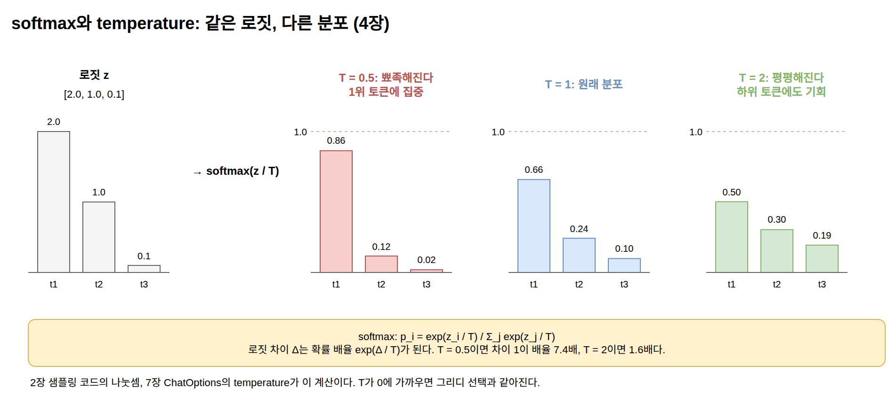

T가 0에 가까우면 가장 점수 높은 토큰만 남고(그리디 선택과 같아진다), T가 크면 균등 분포에 가까워진다. 2장의 샘플링 코드에 있는 나눗셈과 7장의 ``ChatOptions``에서 지정하는 temperature가 이 표의 계산이다.

=== 샘플링과 후보 제한

**샘플링**은 분포에서 실제로 하나를 뽑는 일이다. 확률 0.66인 토큰은 100번 중 66번쯤, 0.10인 토큰도 10번쯤은 뽑힌다. 그래서 같은 분포에서도 매번 다른 결과가 나올 수 있다. 같은 프롬프트에 매번 다른 답이 나오는 것은 모델이 아니라 이 뽑기 단계 때문이다(7장).

절차는 단순하다. 0과 1 사이의 난수 하나를 뽑고, 확률을 앞에서부터 누적하다가 누적합이 난수를 넘어서는 첫 토큰을 고른다.

----
확률:   [0.66, 0.24, 0.10]
누적합: [0.66, 0.90, 1.00]

난수 0.75 → 둘째 토큰 (0.66 < 0.75 ≤ 0.90)
난수 0.30 → 첫째 토큰 (0.30 ≤ 0.66)
----

누적합에서 각 토큰이 차지하는 구간의 길이가 그 토큰의 확률이므로, 난수가 그 구간에 떨어질 확률이 곧 토큰의 확률이다. 2장 ``Main.sampleFrom``이 이 절차이고, temperature와 아래의 top-k, top-p는 모두 난수를 뽑기 전에 확률 배열을 손보는 조작이다.

top-k와 top-p는 뽑기의 후보를 제한한다. top-k는 확률 상위 k개만, top-p는 확률을 큰 순서로 더해 p에 이르는 토큰들까지만 남기고, 남은 토큰들의 확률을 합이 1이 되도록 다시 나눈다. 위의 T = 1 분포에 top-k = 2를 적용하면 세 번째 토큰이 빠지고 남은 두 토큰이 ``[0.73, 0.27]``로 재정규화된다. 남은 확률의 합 0.90으로 각 확률을 나눈 값이다(``0.66 / 0.90 ≈ 0.73``, ``0.24 / 0.90 ≈ 0.27``). top-p = 0.8도 누적합이 0.66에서 0.90으로 넘어가며 0.8에 이르므로 같은 두 토큰이 남는다. temperature가 분포 전체의 모양을 바꾼다면, 이 둘은 꼬리(확률이 낮은 토큰들)를 잘라 낸다. 확률이 낮은 토큰 수천 개는 각각은 작아도 합치면 무시할 수 없는 확률을 차지하므로, 그쪽에서 엉뚱한 토큰이 뽑히는 일을 막는다.

.샘플링과 후보 제한. 누적 확률 막대에서 난수가 떨어진 구간의 토큰을 고르고, top-k와 top-p는 뽑기 전에 꼬리를 잘라 낸다
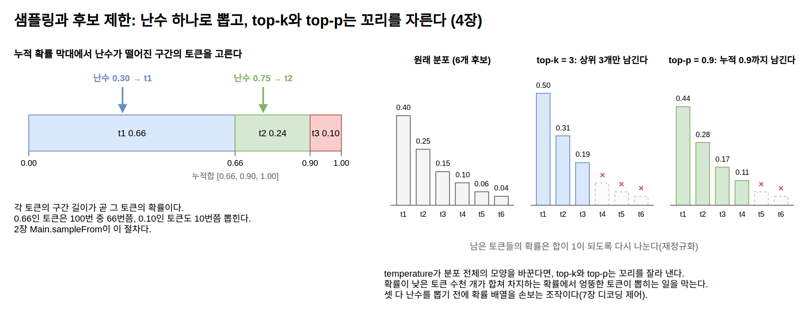

== 로그와 정보량: 모델을 채점하는 손실

=== 로그: 곱을 합으로

**로그**는 지수의 역연산이다. ``ln(x)``는 "e를 몇 제곱해야 x가 되는가"의 답이라서, ``exp``와 ``ln``을 차례로 적용하면 원래 값으로 돌아온다.

----
exp(0) = 1       →  ln(1)     = 0
exp(1) ≈ 2.718   →  ln(2.718) ≈ 1
exp(2) ≈ 7.39    →  ln(7.39)  ≈ 2

ln(0.5) ≈ -0.69,  ln(0.1) ≈ -2.30,  ln(0.01) ≈ -4.61
----

1의 로그는 0이고, 1보다 작은 수의 로그는 음수이며 0에 가까운 수일수록 한없이 작아진다. 확률은 0과 1 사이의 값이므로 확률의 로그는 항상 0 이하다. 이 절의 손실 식에 음의 부호가 붙는 이유가 이것이다.

확률 계산에 로그를 쓰는 이유는 로그가 곱을 합으로 바꾸기 때문이다. `log(a*b) = log(a) + log(b)`. 고등학교에서 배운 로그의 성질 그대로다. 예를 들어 ``ln(0.5 * 0.1) = ln(0.05) ≈ -2.996``은 ``ln(0.5) + ln(0.1) ≈ -0.693 - 2.303``과 같다. 문장의 확률은 조건부 확률 수백 개의 곱이라 1보다 훨씬 작은 수들이 계속 곱해진다. 확률 0.1인 토큰이 300개 이어지면 문장의 확률은 ``10^-300``으로, 배정밀도 부동소수점이 정상적으로 표현하는 가장 작은 수(약 ``2.2 * 10^-308``)에 거의 닿고, 조금만 더 길어지면 0이 된다(언더플로). 로그를 취하면 같은 값이 ``300 * ln(0.1) ≈ -690.8``이라는 평범한 크기의 수가 된다. 그래서 확률 계산은 거의 항상 로그 확률의 합으로 한다.

이 장에서 쓰는 로그의 성질은 세 가지이고, 뒤의 둘은 첫째에서 나온다.

----
log(a * b) = log(a) + log(b)     곱을 합으로: 문장의 확률, 최대 우도
log(a / b) = log(a) - log(b)     비율을 차로: KL 발산, IDF
log(a^n)   = n * log(a)          거듭제곱을 곱으로: 멱법칙
----

앞의 ``300 * ln(0.1)``이 셋째 성질을 쓴 것이다. 0.1을 300번 곱한 값의 로그는 ``ln(0.1)``의 300배다.

=== 최대 우도와 교차 엔트로피

학습의 목표는 *최대 우도*(maximum likelihood)다. 학습 데이터에 모델이 배정하는 확률, 곧 우도를 최대로 만드는 파라미터를 찾는다. 실제로 나온 데이터에 높은 확률을 준 모델일수록 그 데이터를 잘 설명한다고 보는 기준이다. 데이터셋 전체의 우도는 앞 절의 곱의 법칙에 따라 각 위치에서 정답 토큰에 배정한 조건부 확률들의 곱이고, 로그를 취하면 로그 확률의 합이 된다. 모델이 세 위치의 정답 토큰에 확률 0.5, 0.2, 0.9를 주었다면 다음과 같다.

----
우도      = 0.5 * 0.2 * 0.9 = 0.09
로그 우도 = ln(0.5) + ln(0.2) + ln(0.9) ≈ -0.69 - 1.61 - 0.11 = -2.41    (ln(0.09)와 같다)
손실의 합 = 2.41,  위치당 평균 손실 ≈ 0.80
----

로그는 증가 함수(입력이 커지면 출력도 커지는 함수)라서 확률을 최대로 만드는 파라미터와 로그 확률을 최대로 만드는 파라미터는 같다. 로그 우도는 0 이하의 값이므로, 부호를 뒤집어 0 이상인 값을 최소화하는 문제로 만든 것이 2장 학습 루프의 **교차 엔트로피 손실**이다. 2장의 코드가 출력하는 손실은 이 값을 위치 수로 나눈 평균이다. 위치 하나의 손실은 다음 식이다.

----
손실 = -log(정답 토큰에 배정된 확률)

확률 0.9  → 손실 0.11
확률 0.5  → 손실 0.69
확률 0.01 → 손실 4.61
----

정답에 확률 1을 주면 손실이 0이고(``ln(1) = 0``), 확신 있게 틀릴수록 손실이 가파르게 커진다. 제곱 오차와 비교하면 이 가파름이 보인다. 정답 확률이 0.01일 때 제곱 오차 ``(1 - 0.01)²``은 0.98에서 멈추지만 ``-log``는 4.61이고, 확률이 0에 가까워질수록 한없이 커진다. 확신 있는 오답을 훨씬 크게 벌한다.

.교차 엔트로피 손실 -log p. 확률이 0에 가까워질수록 손실이 한없이 커진다
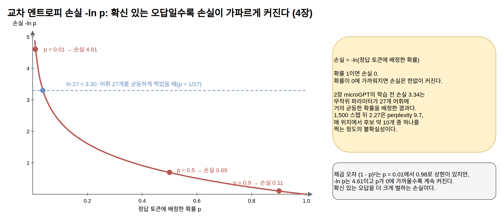

2장에서 학습 전 손실이 약 3.34로 나오는 이유도 이 식으로 설명된다. 파라미터가 무작위인 모델은 어휘 27개에 거의 균등하게 확률 1/27을 배정하므로 손실이 ``-log(1/27) = ln(27) ≈ 3.30``에서 시작한다.

softmax와 교차 엔트로피를 함께 쓰면 계산에도 이점이 있다. 손실을 로짓으로 미분하면(미분은 다음 절에서 다룬다. 여기서는 "로짓을 조금 키울 때 손실이 변하는 비율"로 읽으면 된다) "예측 확률 - 정답(정답 토큰은 1, 나머지는 0)"이라는 간단한 식이 나와서, 확률이 정답에서 벗어난 만큼이 그대로 기울기가 된다. 1장의 자동 미분은 이 식을 몰라도 같은 결과를 계산하지만, 학습이 안정적인 배경에는 이 단순한 기울기가 있다. 앞 절의 softmax 표에 대입하면 이렇다.

----
softmax 확률: [0.66, 0.24, 0.10],  정답이 첫째 토큰이면 정답 벡터는 [1, 0, 0]
손실 = -ln(0.66) ≈ 0.42
로짓의 기울기 = [0.66 - 1, 0.24 - 0, 0.10 - 0] = [-0.34, 0.24, 0.10]
----

정답 토큰의 로짓은 올리고(기울기가 음수이므로 반대 방향으로 움직이면 커진다) 나머지 토큰의 로짓은 각자 배정받은 확률만큼 내리라는 뜻이다. 세 성분의 합은 항상 0이라서 로짓 전체가 한쪽으로 밀리지 않고 확률만 정답 쪽으로 옮겨 간다.

=== 엔트로피와 perplexity

**엔트로피**는 확률 분포의 불확실성을 재는 값으로, 그 분포에서 뽑히는 결과의 평균 ``-log(확률)``이다. 앞 절에서 본 것처럼 ``-log(확률)``은 확률이 낮은 결과일수록 크다. 결과 x마다 이 값을 구하고, 그 결과가 나올 확률 P(x)를 가중치로 곱해 모두 더한다.

----
H(P) = -Σ P(x) * log P(x)

P = [0.66, 0.24, 0.10]이면
H = -(0.66*ln 0.66 + 0.24*ln 0.24 + 0.10*ln 0.10)
  = 0.66*0.416 + 0.24*1.427 + 0.10*2.303
  ≈ 0.274 + 0.343 + 0.230 ≈ 0.85
세 후보가 균등하면 H = ln 3 ≈ 1.10 (최대)
----

한 토큰이 확률 1로 정해져 있으면 엔트로피는 0이고, V개 후보가 균등하면 ``ln(V)``로 최대다. 결과를 미리 맞히기 어려운 분포일수록 엔트로피가 크다.

두 분포 P와 Q 사이의 **교차 엔트로피** ``H(P, Q) = -Σ P(x) * log Q(x)``는 "실제 분포가 P인데 Q라고 믿을 때의 평균 불확실성"이다. 엔트로피 식에서 로그 안의 P만 Q로 바뀌었다. 나오는 x는 P를 따르지만 각 x의 ``-log``는 모델이 믿는 확률 Q(x)로 계산한다. 학습 손실은 P가 정답 토큰에 확률 1을 몰아준 분포이고 Q가 모델의 분포인 특수한 경우라서, 합에서 정답 항 하나만 남아 ``-log Q(정답)``이 된다.

----
P = [1, 0, 0] (정답은 첫째 토큰),  Q = [0.66, 0.24, 0.10] (모델의 예측)
H(P, Q) = -(1*ln 0.66 + 0*ln 0.24 + 0*ln 0.10) = -ln 0.66 ≈ 0.42
----

앞 절에서 구한 손실 0.42와 같은 값이다. 손실이 낮으면 모델이 실제로 나온 토큰에 높은 확률을 주었다는 뜻이다.

언어 모델 평가에서 자주 쓰는 **perplexity**는 평균 교차 엔트로피에 지수 함수를 적용한 값이다.

----
perplexity = exp(평균 손실)
----

로그 단위의 손실을 "몇 개 중 하나를 균등하게 찍는 것과 같은 불확실성인가"라는 개수 단위로 되돌린 것이다. V개 후보가 균등할 때의 엔트로피가 ``ln(V)``이고, ``exp``는 ``ln``의 역연산이라 ``exp(ln(V)) = V``이기 때문이다. 위의 분포 P는 perplexity가 ``exp(0.85) ≈ 2.3``으로, 후보 3개 가운데 하나를 균등하게 찍는 것보다 조금 낫다. 평균 손실 3.3이면 perplexity는 약 27로, 매 위치에서 27개 후보를 놓고 균등하게 찍는 정도의 불확실성이다. 2장에서 1,500 스텝 뒤에 도달하는 평균 손실 2.27은 perplexity 약 9.7로, 후보 약 10개 중 하나를 찍는 정도까지 줄었다. 낮을수록 좋고, 같은 토크나이저를 쓰는 모델끼리만 직접 비교할 수 있다.

.엔트로피와 perplexity. 뾰족한 분포일수록 엔트로피가 낮고, perplexity는 "몇 개 중 하나를 찍는 것과 같은가"로 읽힌다
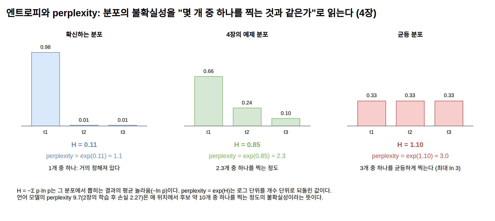

=== KL 발산: 두 분포 사이의 차이 재기

*KL 발산*(Kullback-Leibler divergence)은 두 확률 분포가 얼마나 다른지를 재는 값이다.

----
KL(P || Q) = Σ P(x) * log(P(x) / Q(x))

P = [0.7, 0.2, 0.1], Q = [0.5, 0.3, 0.2]이면
KL(P || Q) = 0.7*ln(0.7/0.5) + 0.2*ln(0.2/0.3) + 0.1*ln(0.1/0.2)
           ≈ 0.2355 - 0.0811 - 0.0693 ≈ 0.085
KL(Q || P) ≈ 0.092
----

``||``는 두 분포를 구분하는 표기이고 연산이 아니다. 식은 "결과 x마다 두 확률의 비율 ``P(x) / Q(x)``에 로그를 취하고, P(x)를 가중치로 곱해 더한다"로 읽는다. P와 Q가 같으면 모든 비율이 1이고 ``ln(1) = 0``이므로 KL 발산은 0이다. 두 분포가 다를수록 커진다. 위 계산의 둘째, 셋째 항처럼 Q가 P보다 큰 자리의 항은 음수지만, 합은 음수가 되지 않는다. P를 기준으로 Q를 재는 값이라서 위의 예처럼 순서를 바꾸면 값이 달라진다(비대칭).

교차 엔트로피와는 정확한 관계식이 있다. `교차 엔트로피(P, Q) = 엔트로피(P) + KL(P || Q)`. 위의 P와 Q로 확인하면 엔트로피(P)가 약 0.802, KL(P || Q)가 약 0.085이고, 교차 엔트로피(P, Q)는 그 합인 약 0.887이다. 학습 데이터의 분포 P는 학습 중에 변하지 않으므로 엔트로피(P)는 상수다. 따라서 2장의 교차 엔트로피 손실이 줄어든 만큼 KL(P || Q)가 줄고, 손실 최소화는 곧 모델의 분포를 데이터의 분포에 가깝게 만드는 일이다.

이 개념은 2부의 학습 기법들에 반복해서 나온다. 지식 증류(5장)에서 student가 teacher의 출력 확률 분포를 따라 배울 때의 손실이 KL 발산이다. RLHF(5장)에서는 반대로 모델이 원래 분포에서 너무 멀어지지 않게 막는 제약이다. 보상 점수만 최대화하면 모델이 보상 모델의 허점을 파고드는 이상한 텍스트를 만들 수 있으므로(보상 해킹), 원래 SFT 모델의 분포에서 멀어질수록 벌점을 주는 KL 페널티를 목적 함수에 더한다. DPO는 이 KL 제약이 붙은 최적화 문제를 별도의 강화학습 없이 닫힌 형태(반복 계산 없이 식 하나로 쓴 해)로 풀어낸 결과다.

.KL 발산과 RLHF의 페널티. 왼쪽은 P와 Q의 항별 기여, 오른쪽은 보상에서 β·KL을 뺀 목적 함수가 최대가 되는 지점
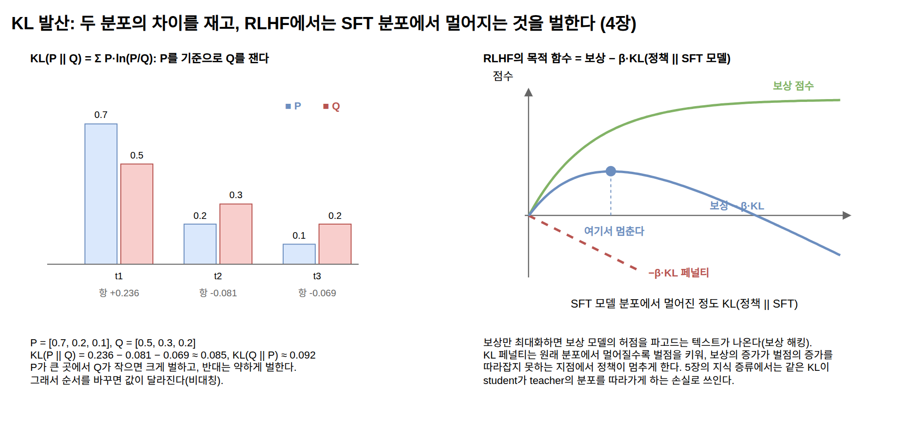

== 미분: 모델이 배우는 방향

=== 도함수와 그래디언트

*도함수*(미분)는 입력이 아주 조금 변할 때 출력이 변하는 비율로, 고등학교 미적분의 그 도함수다. ``f(x) = x²``이면 도함수는 ``2x``이고, ``x = 3``에서 기울기는 6이다. x를 0.001만큼 키우면 f는 약 0.006만큼 커진다. 실제로 ``3.001² = 9.006001``로, 9에서 약 0.006 늘었다. f의 변화량 0.006을 x의 변화량 0.001로 나눈 6이 기울기다. 기울기의 부호는 방향을, 크기는 민감도를 알려 준다. 기울기가 양수면 x를 키울 때 f가 커지고, 음수면 줄어든다. 예를 들어 ``x = -3``에서는 기울기가 -6이라서 x를 키우면 f가 줄어든다.

입력이 여러 개인 함수에서 다른 입력은 고정하고 하나만 움직여 구한 기울기가 **편미분**이고, 모든 입력에 대한 편미분을 모은 벡터가 *그래디언트*(gradient)다.

----
f(x, y) = x² + 3y 이고 (x, y) = (1, 2)이면
∂f/∂x = 2x = 2,  ∂f/∂y = 3
그래디언트 = [2, 3]
----

``∂f/∂x``는 "다른 입력은 그대로 두고 x만 움직였을 때의 기울기"를 적는 표기다. y를 상수로 취급하면 ``3y``는 변하지 않으므로 ``x²``의 도함수 ``2x``만 남고, x를 상수로 취급하면 ``3y``의 도함수 3만 남는다. x를 0.001 늘리면 f는 0.002, y를 0.001 늘리면 0.003 커진다는 뜻이다. 그래디언트는 함수가 가장 가파르게 커지는 방향을 가리키는 벡터이기도 하다. microGPT의 파라미터는 4,192개이므로 손실의 그래디언트는 4,192차원 벡터이고, 1장에서 각 파라미터의 `grad` 필드에 채워지는 "네가 조금 커지면 손실이 얼마나 변하는지"가 그 성분이다.

.그래디언트와 등고선. 그래디언트는 등고선에 수직인 가장 가파른 방향이고, 경사 하강법은 그 반대 방향으로 지그재그를 그리며 최저점에 다가간다
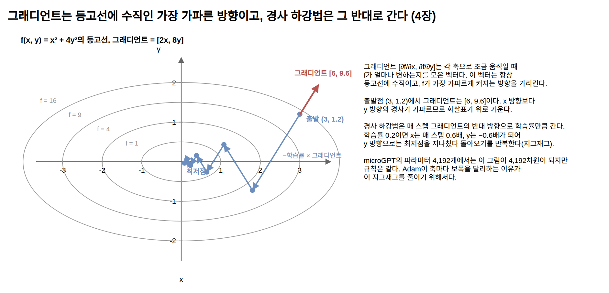

=== 체인 룰

**체인 룰**은 합성 함수의 기울기 계산 규칙이다. ``y = f(g(x))``일 때 x에 대한 y의 기울기는 두 로컬 기울기(각 함수의 바로 앞 입력에 대한 기울기)의 곱이다.

----
dy/dx = dy/dg * dg/dx
----

``dy/dx``는 "x가 조금 변할 때 y가 변하는 비율"을 적는 표기로, 앞 절의 도함수와 같은 뜻이다. x가 변하면 g가 그 ``dg/dx``배만큼 변하고, g가 변하면 y가 다시 그 ``dy/dg``배만큼 변한다. 그래서 두 비율을 곱하면 x에서 y까지의 비율이 된다.

``y = (2x + 1)²``을 ``x = 1``에서 미분해 보자. 안쪽 함수를 ``g = 2x + 1``로 두면 ``g = 3``, ``y = g² = 9``다. 바깥 함수의 로컬 기울기는 ``dy/dg = 2g = 6``, 안쪽 함수의 로컬 기울기는 ``dg/dx = 2``이므로 ``dy/dx = 6 * 2 = 12``다. x가 0.001 커지면 g는 그 2배인 0.002 커지고, y는 다시 그 6배인 0.012 커진다는 뜻이다. 실제로 x를 1.001로 바꾸면 g는 3.002, y는 약 9.012가 된다.

.체인 룰과 역전파. forward가 값을 앞으로 계산하고, backward가 끝에서부터 로컬 기울기를 곱해 나간다
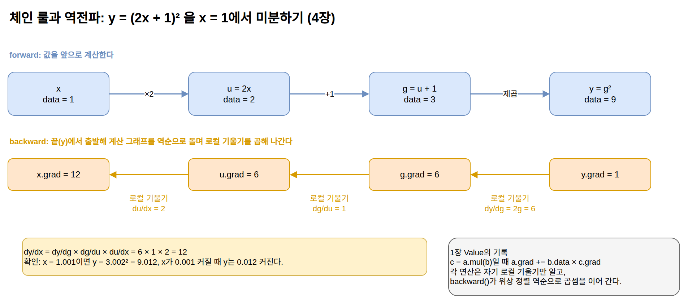

연산이 수만 번 이어져도 규칙은 같다. 각 연산이 자기 로컬 기울기만 알면 끝에서부터 곱해 나가며 모든 파라미터의 기울기를 얻는다. 1장의 역전파가 이 곱셈을 계산 그래프 역순으로 수행하는 절차이고, `Value` 타입에 람다로 저장되는 것이 이 로컬 기울기다. 곱셈 ``c = a.mul(b)``의 람다가 ``a.grad {plus}= b.data * c.grad``인 것은 c를 a로 미분한 로컬 기울기가 b이기 때문이다. 기울기를 대입하지 않고 더하는(`{plus}=`) 이유는 같은 값이 두 곳 이상에서 쓰이면 각 경로에서 온 기울기를 합해야 하기 때문이다.

=== 경사 하강법과 학습률

**경사 하강법**은 그래디언트를 구한 뒤 파라미터를 움직이는 규칙이다.

----
파라미터 = 파라미터 - 학습률 * 기울기
----

기울기는 손실이 커지는 방향을 가리키므로 그 반대로 움직인다. 학습률은 한 걸음의 보폭이다. ``f(x) = x²``에서 ``x = 3``으로 출발해 학습률 0.1로 움직여 보자. 첫 스텝에서 기울기는 ``2 * 3 = 6``이므로 x는 ``3 - 0.1 * 6 = 2.4``가 된다. 같은 계산을 반복하면 x는 3, 2.4, 1.92, 1.54, 1.23으로 최저점 0에 다가가고, 10스텝 뒤에는 ``3 * 0.8^10 ≈ 0.32``가 된다. 걸음마다 기울기가 작아지므로 보폭도 함께 준다. 학습률을 1.1로 잡으면 첫 스텝이 ``3 - 1.1 * 6 = -3.6``이고, 이어서 3, -3.6, 4.32, -5.18로 최저점을 지나쳐 반대편으로 더 멀리 튀기를 반복하며 발산한다. 학습률이 너무 작으면 학습이 느리고, 너무 크면 이렇게 발산한다.

두 경우의 차이는 한 스텝의 갱신식을 정리하면 보인다.

----
x - 학습률 * 2x = (1 - 2 * 학습률) * x

학습률 0.1: 매 스텝 0.8배   → 3, 2.4, 1.92, ...  (수렴)
학습률 1.1: 매 스텝 -1.2배  → 3, -3.6, 4.32, ... (발산)
----

앞의 ``0.8^10``이 이 배율의 10제곱이다. 이 곡선에서는 배율의 절댓값이 1보다 작아야, 곧 학습률이 1보다 작아야 수렴하고, 곡선이 가파를수록(2x의 2가 클수록) 그 경계가 낮아진다. 예를 들어 ``f(x) = 5x²``이면 기울기가 ``10x``라서 배율이 ``1 - 10 * 학습률``이고, 학습률이 0.2보다 작아야 수렴한다. 손실 곡면의 가파름은 미리 알 수 없으므로 실제 학습에서는 학습률을 실험으로 고른다.

.경사 하강법과 학습률. 학습률 0.1은 최저점으로 수렴하고 1.1은 발산한다
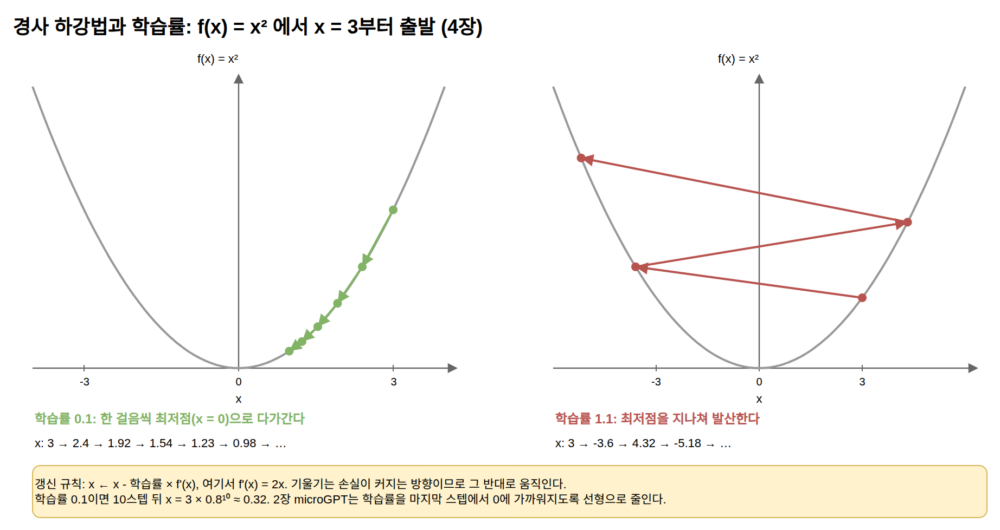

실제 학습에서는 학습률을 스텝에 따라 바꾸는 일이 흔하다. 2장의 microGPT는 학습률을 마지막 스텝에서 0에 가까워지도록 선형으로 줄인다. 처음에는 큰 보폭으로 빠르게 내려가고, 최저점 근처에서는 보폭을 줄여 지나치지 않게 한다.

=== Adam: 보폭을 파라미터마다 조절하기

2장의 옵티마이저 Adam은 위의 기본 규칙에 이동 평균 두 개를 더한 것이다. 이동 평균은 새 값을 조금씩 섞어 넣으며 최근 값들의 평균을 따라가는 값이다.

첫째는 기울기의 이동 평균 m으로, 스텝마다 ``m = β1*m + (1-β1)*기울기``로 갱신한다. β1(베타 1)은 0과 1 사이의 상수로, 클수록 과거 기울기의 비중이 크다. β1이 0.9이면 직전까지의 평균을 90%, 새 기울기를 10% 반영한다. 최근 기울기들이 같은 방향이면 m이 커지고, 방향이 요동치면 서로 상쇄되어 작아진다.

----
β1 = 0.9, m은 0에서 시작
기울기가 계속 1이면:      m = 0.1, 0.19, 0.271, 0.344, ...    (1을 향해 커진다)
기울기가 1, -1을 오가면:  m = 0.1, -0.01, 0.091, -0.018, ...  (0 근처에 머문다)
----

둘째는 기울기 제곱의 이동 평균 v로, 그 파라미터의 기울기가 평소에 얼마나 큰지를 기록한다. 제곱하면 부호가 없어지므로 방향이 요동쳐도 상쇄되지 않고 크기만 남는다. 갱신량은 ``학습률 * m / sqrt(v)``다. 기울기가 늘 큰 파라미터는 ``sqrt(v)``로 나뉘어 보폭이 줄고, 늘 작은 파라미터는 보폭이 커진다. 파라미터 4,192개가 각자 다른 학습률을 쓰는 효과다. ``sqrt(v)``에 아주 작은 수 ε(엡실론)을 더해 0으로 나누는 일을 막는다.

두 이동 평균이 0에서 시작하므로 초기 몇 스텝은 실제보다 작게 추정된다. 위의 예에서 기울기가 계속 1인데도 m이 0.1에서 출발한 것이 이 현상이다. 2장 코드에서 ``1 - β^step``으로 나누는 부분이 이것을 보정한다. 2장 코드의 값(β1이 0.9, β2가 0.95)으로 첫 스텝을 따라가면 보정의 효과가 보인다.

----
첫 스텝의 기울기가 g이면
이동 평균: m = 0.9 * 0 + 0.1 * g = 0.1 * g,  v = 0.95 * 0 + 0.05 * g² = 0.05 * g²
보정:      m / (1 - 0.9) = g,  v / (1 - 0.95) = g²
갱신량:    학습률 * g / sqrt(g²) = 학습률 * (g의 부호)

보정이 없으면: 학습률 * 0.1g / sqrt(0.05g²) ≈ 0.45 * 학습률
----

보정한 첫 스텝의 갱신량은 기울기의 크기와 무관하게 정확히 학습률만큼이다. Adam의 보폭을 정하는 것은 기울기의 크기가 아니라 부호와 그 일관성이다. 그래서 단순 경사 하강법보다 학습률 선택에 덜 민감하고, 기울기의 크기가 파라미터마다 수천 배 다른 신경망을 학습률 하나로 학습할 수 있다.

== 평균과 분산: 값의 규모를 관리하기

=== 평균, 분산, 표준편차

**평균**은 값들의 중심이고, **분산**은 값들이 평균에서 흩어진 정도(편차 제곱의 평균)다. 분산의 제곱근이 **표준편차**로, 단위가 원래 값들과 같다.

----
값:     [2, 4, 4, 4, 5, 5, 7, 9]      평균 5
편차:   [-3, -1, -1, -1, 0, 0, 2, 4]
분산:   (9 + 1 + 1 + 1 + 0 + 0 + 4 + 16) / 8 = 4
표준편차: sqrt(4) = 2
----

편차는 각 값에서 평균을 뺀 것이다. 편차를 그대로 평균 내면 양수와 음수가 상쇄되어 항상 0이 되므로 제곱해서 평균을 낸다. 제곱하면 단위도 제곱이 되므로, 제곱근을 취해 원래 단위로 되돌린 표준편차를 "값들이 평균에서 보통 이만큼 떨어져 있다"로 읽는다. 위 예에서는 값들이 평균 5에서 보통 2쯤 떨어져 있다.

신경망에서 이 개념이 중요한 이유는 값의 규모 관리다. 층을 거칠수록 값의 분산이 커지거나 작아지기만 하면 기울기가 폭주하거나 소멸해서 학습이 진행되지 않는다. 예를 들어 층마다 표준편차가 1.1배씩 커지면 100층 뒤에는 약 13,800배가 되고, 0.9배씩 줄면 약 0.00003배가 된다.

=== 정규화와 sqrt(d) 스케일링

2장의 정규화(RMSNorm)는 벡터를 자기 크기로 나눠 규모를 일정하게 되돌린다. 성분들의 제곱 평균의 제곱근(RMS, root mean square)으로 각 성분을 나누면 결과 벡터의 RMS가 1이 된다.

----
x = [3, 4]
제곱 평균: (3² + 4²) / 2 = 12.5
RMS:       sqrt(12.5) ≈ 3.54
정규화:    [3 / 3.54, 4 / 3.54] ≈ [0.85, 1.13]    (제곱 평균이 (0.72 + 1.28) / 2 = 1)
----

성분 사이의 비율(3 대 4)은 그대로이고 규모만 1로 맞춰진다. 성분들의 평균이 0이면 RMS는 표준편차와 같으므로 "표준편차를 1로 맞추는" 정규화다. 원조 트랜스포머의 LayerNorm은 평균을 먼저 빼고 표준편차로 나누는데, RMSNorm은 평균 빼기를 생략했다.

어텐션 점수를 ``headDim``의 제곱근으로 나누는 것(2장)도 같은 원리다. 서로 독립인 확률 변수들, 곧 한쪽의 값이 다른 쪽에 영향을 주지 않는 무작위 값들을 더하면 합의 분산은 각 분산의 합이 된다. 평균 0, 분산 1인 독립적인 값들로 된 d차원 벡터 두 개를 내적하면, 더하는 항 ``q_i * k_i``가 각각 평균 0, 분산 1이고 항이 d개이므로 결과의 분산은 d, 표준편차는 ``sqrt(d)``다.

----
Var(q_1 k_1 + q_2 k_2 + ... + q_d k_d) = 1 + 1 + ... + 1 = d
Var((q·k) / sqrt(d)) = d / d = 1
----

``Var( )``는 분산이다. 항이 d개인데 표준편차가 d배가 아니라 ``sqrt(d)``배인 것은 양수 항과 음수 항이 섞여 일부가 상쇄되기 때문이다. 둘째 줄은 값을 c로 나누면 표준편차는 c로, 분산은 c²으로 나뉜다는 규칙을 쓴 것이다. ``sqrt(d)``로 나누면 분산이 d로 나뉘어 1이 된다.

d가 256이면 나누기 전 점수의 표준편차가 ``sqrt(256) = 16``이다. 그 크기의 로짓을 softmax에 넣으면 점수 차이가 16만 나도 확률 비율이 e^16^, 약 890만 배로 벌어져 한 토큰에 확률이 몰린다. 내적을 ``sqrt(d)``로 나누면 차원이 몇이든 점수의 분산이 1 근처로 유지된다.

.값의 규모 관리. 블록을 지날수록 커지거나 작아지는 표준편차를 RMSNorm이 1로 되돌리고, sqrt(d)가 어텐션 점수의 폭을 16에서 1로 맞춘다
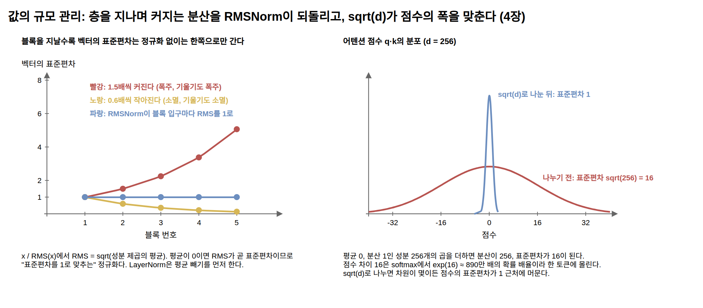

== 더 공부하려면

이 장의 값들을 직접 계산해 보려면 ``examples/math-lab``의 검산 실습 코드를 쓴다. 이 장과 부록 통계 참고의 절 순서를 따라가며 본문의 값을 Apache Commons Math로 다시 구해 맞는지 확인한다. 숫자뿐 아니라 "교차 엔트로피는 엔트로피와 KL 발산의 합이다", "행렬 곱 두 개를 이은 결과는 행렬 곱 한 번과 같다", "내적을 ``sqrt(d)``로 나누면 차원과 무관하게 분산이 1 근처로 유지된다" 같은 이 장의 서술도 코드로 확인한다. temperature나 학습률 같은 값을 바꿔 가며 결과가 어떻게 달라지는지 보는 데 쓰면 된다.

개념들이 한 프로그램 안에서 어떻게 이어지는지 보려면 1장과 2장의 microGPT 예제(``examples/java/microgpt``)가 값을 직접 바꿔 보기에 가장 좋다. 손실, softmax, 기울기가 모두 스칼라 단위의 코드로 드러나 있다. 더 깊은 수학은 부록 더 읽을거리에서 소개하는 Karpathy의 Neural Networks: Zero to Hero 강의와 3Blue1Brown의 시각화 시리즈에서 볼 수 있다. 두 자료는 이 장과 같은 순서의 개념을 영상으로 다룬다.

여기까지가 1부다. 다음 토큰 예측이라는 문제 정의에서 출발해 학습과 추론을 코드로 확인했고, 프로덕션 규모에서 그 추론에 드는 비용의 구조를 측정했으며, 이 장에서 그 코드 뒤의 수학을 정리했다. 본문의 다른 장이 참조하는 통계 개념은 부록 통계 참고에 있다. 2부에서는 이렇게 동작하는 모델에 정보를 전달하는 방법을 분류한다. 학습으로 파라미터를 바꾸는 모델 레이어, 추론 시점에 토큰으로 넣는 프롬프트 레이어, 어느 쪽에도 깔끔하게 속하지 않는 회색지대 순이다.
